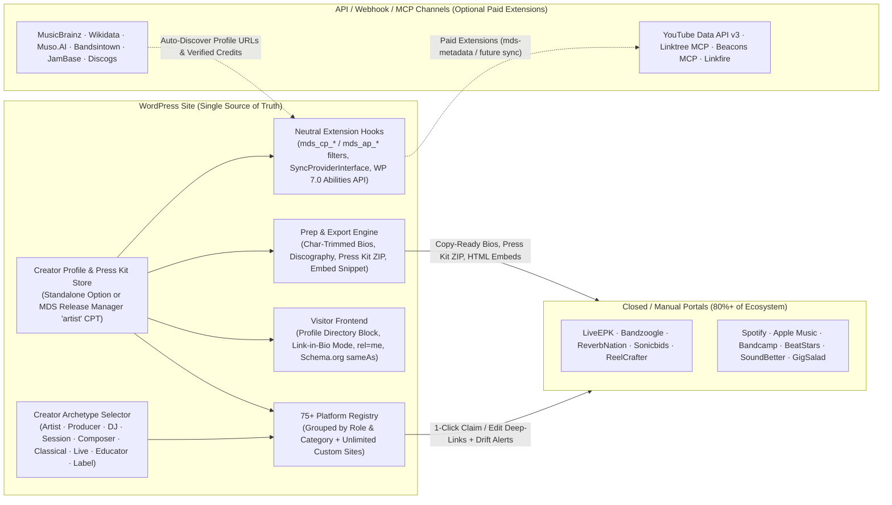

# Music Creator Profile, EPK & Directory Ecosystem — Comprehensive Feasibility Research

**Topic Slug:** `artist-profiles`  
**Target Tier:** New **Free Tier** WordPress.org Plugin (Standalone + Deep MDS Suite Integration)  
**Target Audience:** All music creators — recording artists, bands, vocalists, beatmakers, producers, DJs, session musicians, audio engineers, songwriters, film/game/classical composers, live/event entertainers, music educators, streamers, and record labels.  
**Date:** 2026-11-27

---

## 1. Executive Summary & Core Findings

Across all music creator disciplines, an active creator or label routinely maintains **15 to 40+ external profiles** across EPK builders, DSP artist portals, beat/sample marketplaces, DJ/electronic hubs, freelance audio marketplaces, sync/licensing catalogs, sheet-music stores, gig-booking networks, link-in-bio tools, direct-to-fan monetization platforms, and credit/analytics registries.

**Three Strategic Takeaways from Surveying 75+ Platforms:**
1. **Closed Write Surfaces Dominate (80%+ of Platforms):** Virtually none of the EPK builders (LiveEPK, Bandzoogle, ReverbNation, Sonicbids), DSP artist portals (Spotify, Apple Music, Amazon Music, Deezer, TIDAL, Pandora), beat stores (BeatStars, Airbit, Traktrain), freelance marketplaces (SoundBetter, AirGigs, EngineEars), or event booking networks (GigSalad, The Bash, Encore Musicians, Indie on the Move, Sofar Sounds) provide a public write API to create or edit profiles.
2. **High-Value Open Read, Webhook & MCP Surfaces Exist:**
   - **Open / Free Read Registries:** MusicBrainz (`inc=url-rels`), Wikidata, Discogs, Genius, Audius, Hearthis.at.
   - **Official Creator/Live/Credits APIs:** **Muso.AI** (REST API + OpenID Connect SSO + embeddable credit widgets), **Bandsintown** (`rest.bandsintown.com`), **JamBase** (REST API + MCP Server), **YouTube Data API v3** (`channels.update`), **Twitch Helix API**, **Patreon** (JSON:API + webhooks), **Gumroad** (REST + webhooks), **Buy Me a Coffee** (REST + webhooks), **Ko-fi** (webhooks).
   - **Emerging MCP Servers:** **Linktree** (`mcp.linktr.ee`), **Beacons.ai** (`beacons.ai/api/v001/creator/mcp`), **JamBase**, and **Chartmetric** now expose Model Context Protocol (MCP) endpoints — pairing naturally with WordPress 7.0's **Abilities API (`meta.mcp.public`)**.
3. **Creator-Type Classification Is Essential for UX:** Dumping 75+ platforms into one flat screen overwhelms users. Classifying creators into **9 Creator Archetypes (Personas)** lets the plugin offer tailored **Onboarding Starter Kits** (a classical composer sees MuseScore, Bachtrack, Operabase, ReelCrafter, IMDbPro; a beatmaker sees BeatStars, Airbit, Traktrain, Splice, SoundBetter, Muso.AI; an indie band sees LiveEPK, Bandzoogle, Bandsintown, Spotify for Artists, Bandcamp, Linktree) while still letting any user toggle or add custom sites.

---

## 2. Music Creator Archetype Classification

| Creator Archetype (Role) | Primary External Profile Goals | Recommended Starter Platforms |
| :--- | :--- | :--- |
| **1. Recording Artist / Band / Vocalist** | Streaming identity, press kits, fan links, merch, tour dates | Spotify for Artists, Apple Music for Artists, YouTube OAC, Amazon Music, Bandcamp, Bandzoogle, LiveEPK, ReverbNation, Bandsintown, Linktree, Genius, Musixmatch Pro |
| **2. Beatmaker / Music Producer** | Beat licensing storefronts, credits, sample packs, collabs | BeatStars, Airbit, Traktrain, SoundCloud, Splice, BandLab, Soundtrap, Muso.AI, SoundBetter, YouTube, Gumroad, Linktree |
| **3. DJ / Electronic / Remixer** | Mix hosting, club/festival listings, tracklists, lossless stores, live sets | Resident Advisor, Beatport, Traxsource, Mixcloud, Hearthis.at, 1001Tracklists, SoundCloud, Twitch (DJ Program), Bandcamp, Bandsintown |
| **4. Session Musician / Mixing & Mastering Engineer** | Hireable portfolios, verified discography credits, studio booking | SoundBetter, EngineEars, AirGigs, Muso.AI, Jaxsta, Vampr, Discogs, LinkedIn, Linktree |
| **5. Songwriter / Film, TV & Game Composer / Sync** | Demo reels, sync pitching, media credits, rights & lyrics | ReelCrafter, DISCO (`disco.ac`), Songtradr, Pond5, AudioJungle, IMDbPro, VGMdb, Muso.AI, Musixmatch Pro, Genius, SoundCloud |
| **6. Classical / Choral / Sheet Music Creator** | Score publishing, arrangements, repertoire & concert calendars | MuseScore, ArrangeMe, Sheet Music Plus, Soundslice, Bachtrack, Operabase, Bandcamp, YouTube |
| **7. Live / Touring / Event Entertainer** | Private/wedding/venue bookings, EPKs, stage plots, gig calendars | LiveEPK, Sonicbids, GigSalad, The Bash, Encore Musicians, Indie on the Move, JamBase, Bandsintown, Songkick Tourbox, Sofar Sounds, Bandzoogle |
| **8. Music Educator / Streamer / Content Creator** | Tabs/lessons, memberships, tips, digital downloads, newsletters | YouTube, Twitch, Patreon, Ko-fi, Buy Me a Coffee, Gumroad, Substack, Soundslice, Ultimate Guitar, MuseScore |
| **9. Record Label / Collective / Artist Manager** | Roster hubs, smart-link campaigns, reporting, A&R analytics | Bandcamp Labels, Discogs, Beatport Labels, Traxsource, Resident Advisor, Linkfire, Feature.fm, Chartmetric, Viberate, Songstats, MusicBrainz |

---

## 3. Comprehensive Platform Feasibility Matrix (75+ Sites)

### 3.1 EPK, Press Kit & Musician Website Builders

| Platform | Creator Roles | Direction | Founded | Popularity | Cost / Tiers | API / Automation & Limits | Longevity | WP Effort | Verdict |
| :--- | :--- | :--- | :--- | :--- | :--- | :--- | :--- | :--- | :--- |
| **Bandzoogle (Onesheets)** | Band, Live, Solo | `Prep` + `Embed` | 2003 (23y) | Gold-standard indie site & EPK builder | $8–$20/mo | No public API/webhooks. Supports **Custom HTML/Script embeds** & native Bandsintown/Bandcamp/Spotify widgets. | `Very High` | `Low` | **Build Now** (Prep + Embed) |
| **LiveEPK** | Band, Live | `Prep Only` | ~2024 (2y) | Growing gig-booking EPK (stage plots, riders) | Free + $5/mo Pro | No public API. Web editor with auto-embeds (Spotify, Apple, Bandcamp, SoundCloud). | `Medium` | `Low` | **Build Now** (Registry + Prep) |
| **ReverbNation** | Band, Solo, Live | `Prep Only` | 2006 (20y) | Legacy indie promo/EPK portal (BandLab-owned) | Freemium | No public developer API or OAuth. Closed/partner-only. | `Medium` | `Low` | **Build Now** (Registry + Prep) |
| **Sonicbids** | Band, Live | `Prep Only` | 2000 (26y) | Classic festival/gig submission EPK network | Paid + tokens | No public API. Web dashboard only. | `Medium` | `Low` | **Build Now** (Registry + Prep) |
| **ArtistKit (SaaS)** | Band, DJ, Solo | `Prep Only` | ~2023 (3y) | Modern minimalist 1-page EPK & release hub | Freemium | No public API. Fixed-layout web builder. | `Medium` | `Low` | **Build Now** (Registry + Prep) |
| **Tunepact** | Band, Producer | `Prep Only` | ~2023 (3y) | AI-assisted release marketing & EPK generator | Freemium | No public API. Web dashboard only. | `Medium` | `Low` | **Build Now** (Registry + Prep) |
| **Storydoc** | Band, Label, Sync | `Prep Only` | 2019 (7y) | Interactive scrollable press/pitch decks with tracking | Paid SaaS | No public music profile API; embeddable decks. | `High` | `Low` | **Build Now** (Registry) |

### 3.2 Major DSP Artist Portals & Indie Streaming Platforms

| Platform | Creator Roles | Direction | Founded | Popularity | Cost / Tiers | API / Automation & Limits | Longevity | WP Effort | Verdict |
| :--- | :--- | :--- | :--- | :--- | :--- | :--- | :--- | :--- | :--- |
| **Spotify for Artists** | All Recording | `Prep Only` | 2017 (9y) | Mandatory DSP portal | Free | Web API is read-only & omits bio. No write API. **Bio cap: 1,500 chars.** | `Very High` | `Low` | **Build Now** (Deep-Link + 1,500c Bio) |
| **Apple Music for Artists** | All Recording | `Prep Only` | 2019 (7y) | Mandatory DSP portal | Free | Catalog API is read-only. Bios sourced via **Xperi (AllMusic)**. | `Very High` | `Low` | **Build Now** (Deep-Link + Xperi Guide) |
| **YouTube OAC / Studio** | All Creators | `Push` + `Prep` | 2005 (21y) | Essential video & YT Music hub | Free | **YouTube Data API v3** (`channels.update` via OAuth 2.0) updates channel description; OAC card in Studio. | `Very High` | `Low`/`Med` | **Build Now** (Prep) / **Optional Paid** (Push) |
| **Amazon Music for Artists** | All Recording | `Prep Only` | 2019 (7y) | Major DSP + Alexa portal | Free | No artist-profile write API; web/mobile portal only. | `Very High` | `Low` | **Build Now** (Registry + Prep) |
| **Deezer for Creators** | All Recording | `Prep Only` | 2019 (7y) | Major EU/global DSP portal | Free | No artist-profile write API; web portal only. | `High` | `Low` | **Build Now** (Registry + Prep) |
| **TIDAL Artist Home** | All Recording | `Prep Only` | 2022 (4y) | Hi-Fi DSP creator portal | Free | No public profile write API; web portal only. | `High` | `Low` | **Build Now** (Registry + Prep) |
| **Pandora AMP** | Recording, Live | `Prep Only` | 2014 (12y) | Major US radio/streaming artist portal | Free | No public profile write API; web portal only. | `High` | `Low` | **Build Now** (Registry + Prep) |
| **Bandcamp** | Band, DJ, Label, Classical | `Prep Only` | 2008 (18y) | Essential indie direct-to-fan & merch hub | Free (rev share) | Enterprise/label OAuth API only; no public profile write API. Custom header links use HTML image maps. | `High` | `Low` | **Build Now** (Registry + Prep) |
| **SoundCloud** | Producer, DJ, Band, Composer | `Read` + `Prep` | 2007 (19y) | Huge indie/electronic audio hub | Free + Pro | OAuth 2.1 PKCE read API (`web-profiles`). **Bio cap: 4,000 chars; 10 web links.** | `High` | `Low` | **Build Now** (Prep + 4,000c Bio) |
| **Audiomack** | Producer, Band, DJ | `Read` + `Prep` | 2012 (14y) | Major hip-hop/Afrobeats/indie hub | Free | Read API (`GET /v1/artist/{slug}`); profile writes partner-gated. | `High` | `Low` | **Build Now** (Registry + Prep) |
| **Audius** | Producer, DJ, Indie | `Read` + `Push` | 2018 (8y) | Leading decentralized streaming protocol | Free | Zero-auth Read API (`api.audius.co`); writes require signed wallet tx. | `Medium` | `Low` | **Build Now** (Registry + Prep) |

### 3.3 Beatmakers, Producers, DJs & Electronic Music Platforms

| Platform | Creator Roles | Direction | Founded | Popularity | Cost / Tiers | API / Automation & Limits | Longevity | WP Effort | Verdict |
| :--- | :--- | :--- | :--- | :--- | :--- | :--- | :--- | :--- | :--- |
| **BeatStars** | Beatmaker, Producer | `Prep` + `Embed` | 2008 (18y) | #1 beat-licensing marketplace | Free + Pro Page | No open public REST API; embeddable Pro Page players. | `Very High` | `Low` | **Build Now** (Registry + Prep) |
| **Airbit** | Beatmaker, Producer | `Prep` + `Embed` | 2009 (17y) | Top beat-selling marketplace & Infinity Store | Free + Paid | No public developer API; embeddable store players + mailing list keys. | `High` | `Low` | **Build Now** (Registry + Prep) |
| **Traktrain** | Beatmaker, Producer | `Prep` + `Embed` | 2015 (11y) | Popular curated beat marketplace | Invite/Free + Paid | No public API; embeddable player widgets. | `High` | `Low` | **Build Now** (Registry + Prep) |
| **Beatport** | DJ, Electronic, Label | `Read (Gated)` + `Prep` | 2004 (22y) | #1 electronic/DJ music store & charts | Distribution | **v4 REST API** (`api.beatport.com/v4`) with OpenAPI docs, strictly Partner-Portal gated (OAuth 2.0). | `Very High` | `Low` | **Build Now** (Registry + Prep) |
| **Traxsource** | DJ, Electronic, Label | `Prep` (Label API) | 2004 (22y) | Leading house/underground DJ store | Distribution | Label Reporting API only (verified labels); artist profiles managed via web. | `High` | `Low` | **Build Now** (Registry + Prep) |
| **Resident Advisor (RA)** | DJ, Electronic, Label | `Prep Only` | 2001 (25y) | Global electronic music artist/event/label bible | Free | No public API (unofficial GraphQL scraping exists — avoid). | `Very High` | `Low` | **Build Now** (Registry + Prep) |
| **Mixcloud** | DJ, Radio, Educator | `Read` + `Prep` | 2008 (18y) | #1 long-form DJ mix & radio platform | Free + Pro | Clean Read API (`api.mixcloud.com`). **Bio cap: 1,000 chars; 5 social + 5 custom links.** | `High` | `Low` | **Build Now** (Prep + 1,000c Bio) |
| **Hearthis.at** | DJ, Producer | `Read` + `Embed` | 2013 (13y) | Popular EU SoundCloud/Mixcloud alternative (lossless) | Free + Pro | **Public Developer API** & embeddable player widgets. | `Medium–High` | `Low` | **Build Now** (Registry + Prep) |
| **1001Tracklists** | DJ, Producer | `Prep Only` | 2011 (15y) | Global DJ set & tracklist database | Free | No public API; web artist/tracklist profiles. | `High` | `Low` | **Build Now** (Registry + Prep) |
| **Splice** | Producer, Sound Designer | `Prep Only` | 2013 (13y) | Leading sample/sound-pack cloud platform | Paid | No public consumer profile API. | `Very High` | `Low` | **Build Now** (Registry) |
| **BandLab / Soundtrap** | Producer, Educator | `Prep` / `Import` | 2015 / 2013 | Massive social DAW & collab ecosystems | Free + Paid | BandLab: no public profile API. Soundtrap: Public Import API (`audio1`/`midi1`). | `Very High` | `Low` | **Build Now** (Registry) |

### 3.4 Session Musicians, Audio Engineers & Verified Credits

| Platform | Creator Roles | Direction | Founded | Popularity | Cost / Tiers | API / Automation & Limits | Longevity | WP Effort | Verdict |
| :--- | :--- | :--- | :--- | :--- | :--- | :--- | :--- | :--- | :--- |
| **Muso.AI** | Engineer, Producer, Session, Songwriter | `Read` + `Embed` | 2018 (8y) | Leading verified music credits graph | Free + Pro; API keys | **Public REST API** (`api.platform.muso.ai`, `x-api-key`), **Login with Muso (OIDC)**, & **embeddable credit widgets** (`mpk_`). | `High` | `Low`/`Med` | **Build Now** (Registry + Embed) / **Build Next** (API) |
| **SoundBetter** | Engineer, Session, Producer | `Prep Only` | 2012 (14y) | #1 music freelancer marketplace (Spotify-owned) | Free + Pro | **No public API.** Closed marketplace. | `Very High` | `Low` | **Build Now** (Registry + Prep) |
| **EngineEars** | Mixing/Mastering Engineer | `Prep Only` | 2020 (6y) | Fast-growing studio & engineer booking ecosystem | Free + Paid | No public API (pulls verified credits from Muso.AI). | `High` | `Low` | **Build Now** (Registry + Prep) |
| **AirGigs** | Session, Vocalist, Engineer | `Prep Only` | 2012 (14y) | Established session musician hire marketplace | Free (commission) | No public API. | `High` | `Low` | **Build Now** (Registry + Prep) |
| **Jaxsta** | All Credited Creators | `Read (B2B)` + `Prep` | 2015 (11y) | Official credits database (Recording Academy partner) | Free + Pro; B2B API | Commercial/Enterprise B2B API only; public web profiles. | `Medium–High` | `Low` | **Build Now** (Registry + Prep) |
| **Vampr** | Session, Band, Producer | `Prep Only` | 2015 (11y) | "LinkedIn for musicians" networking & collab app | Freemium | No public profile API. | `High` | `Low` | **Build Now** (Registry) |

### 3.5 Songwriters, Composers, Sync Licensing & Sheet Music

| Platform | Creator Roles | Direction | Founded | Popularity | Cost / Tiers | API / Automation & Limits | Longevity | WP Effort | Verdict |
| :--- | :--- | :--- | :--- | :--- | :--- | :--- | :--- | :--- | :--- |
| **ReelCrafter** | Composer, Sync, Sound Designer | `Prep` + `Embed` | 2016 (10y) | #1 composer demo-reel & portfolio builder | Paid ($12–$30/mo) | Web reel builder with analytics & embeddable reels; no open write API. | `High` | `Low` | **Build Now** (Registry + Prep) |
| **DISCO (`disco.ac`)** | Sync, Composer, Label | `Prep` (Enterprise API) | 2016 (10y) | Industry-standard music supervisor pitching hub | Paid ($15+/mo) | Enterprise API for catalog sync; individual creators manage via web. | `Very High` | `Low` | **Build Now** (Registry + Prep) |
| **Songtradr** | Composer, Sync, Band | `Prep Only` | 2014 (12y) | Major B2B sync marketplace (owns Bandcamp) | Free + Pro | Enterprise B2B licensing API; creator profiles web-only. | `High` | `Low` | **Build Now** (Registry + Prep) |
| **Pond5 / AudioJungle** | Composer, Stock Audio | `Prep Only` | 2006 / 2008 | Top royalty-free stock music marketplaces | Rev share | Creator storefronts managed via web dashboards. | `High` | `Low` | **Build Now** (Registry) |
| **IMDb / IMDbPro** | Film/TV/Game Composer | `Prep Only` | 1990 (36y) | Mandatory film/TV credit & representation directory | Free / Pro | No public write API; claims/credits via IMDbPro. | `Very High` | `Low` | **Build Now** (Registry + Schema `sameAs`) |
| **VGMdb** | Video Game / Anime Composer | `Prep Only` | 2006 (20y) | Premier game soundtrack & composer database | Free | No official public API (community-maintained wiki). | `High` | `Low` | **Build Now** (Registry + Schema `sameAs`) |
| **MuseScore** | Classical, Composer, Educator | `Prep` + `Embed` | 2002 (24y) | Massive score-sharing library & notation hub | Free + Pro | Embeddable interactive score players; no open profile write API. | `Very High` | `Low` | **Build Now** (Registry + Prep) |
| **ArrangeMe / Sheet Music Plus** | Composer, Arranger, Classical | `Prep Only` | 1997 / 2021 | Hal Leonard self-publishing sheet music network | Free (rev share) | Web publisher portal only. | `Very High` | `Low` | **Build Now** (Registry) |
| **Soundslice** | Educator, Composer, Transcriber | `Prep` + `Embed` | 2012 (14y) | Interactive audio-synced sheet music & tab platform | Free + Paid | Embeddable interactive notation player; MusicXML import. | `High` | `Low` | **Build Now** (Registry + Embed) |
| **Bachtrack / Operabase** | Classical, Opera, Conductor | `Prep Only` | 2008 / 1996 | Global classical/opera artist & concert directories | Free + Pro | Institutional/web profiles; no open self-serve write API. | `Very High` | `Low` | **Build Now** (Registry + Prep) |

### 3.6 Live Touring, Gig Booking & Event Marketplaces

| Platform | Creator Roles | Direction | Founded | Popularity | Cost / Tiers | API / Automation & Limits | Longevity | WP Effort | Verdict |
| :--- | :--- | :--- | :--- | :--- | :--- | :--- | :--- | :--- | :--- |
| **Bandsintown for Artists** | Band, DJ, Live | `Read` + `Prep` | 2007 (19y) | #1 indie tour tracker (syncs to Spotify/Apple) | Free | **Official Public REST API** (`rest.bandsintown.com`, `app_id`) for artist info & events. | `Very High` | `Low` | **Build Now** (Prep) / **Optional Paid** (Read Sync) |
| **JamBase** | Band, Live, Touring | `Read` + `MCP` | 1998 (28y) | Major live music & touring artist database | Free/API Tiers | **Official REST API & MCP Server** (`data.jambase.com`) for touring schedules & artist profiles. | `Very High` | `Low` | **Build Now** (Registry) / **Optional Paid** (API) |
| **Songkick Tourbox** | Band, DJ, Live | `Prep` + `Embed` | 2007 (19y) | Major concert listing hub (WMG) | Free | Public API keys restricted; native **Tourbox HTML widgets**. | `High` | `Low` | **Build Now** (Registry + Embed) |
| **GigSalad** | Live, Cover/Event Band | `Prep Only` | 2007 (19y) | Major US event/wedding/party booking marketplace | Freemium | No public API. Web storefront only. | `High` | `Low` | **Build Now** (Registry + Prep) |
| **The Bash** | Live, DJ, Event Band | `Prep Only` | 1997 (29y) | Major US event-vendor & band marketplace (ex-GigMasters) | Paid | No public API. | `High` | `Low` | **Build Now** (Registry + Prep) |
| **Encore Musicians** | Live, Classical, UK/EU | `Prep Only` | 2014 (12y) | Leading UK/EU wedding & event musician network | Free (commission) | No public API. | `High` | `Low` | **Build Now** (Registry + Prep) |
| **Indie on the Move** | Touring Band, Solo | `Prep Only` | 2007 (19y) | DIY indie venue directory & booking tool | Freemium | No public API. | `High` | `Low` | **Build Now** (Registry + Prep) |
| **Sofar Sounds** | Indie Solo, Acoustic, Band | `Prep Only` | 2009 (17y) | Global curated intimate-concert network | Free (apply) | No public API. | `High` | `Low` | **Build Now** (Registry) |

### 3.7 Link-in-Bio, Smart Links, Pitching & Direct-to-Fan Monetization

| Platform | Creator Roles | Direction | Founded | Popularity | Cost / Tiers | API / Automation & Limits | Longevity | WP Effort | Verdict |
| :--- | :--- | :--- | :--- | :--- | :--- | :--- | :--- | :--- | :--- |
| **Linktree** | All Creators | `Prep` + `Push (MCP)` | 2016 (10y) | #1 link-in-bio hub (50M+ users) | Freemium | No open REST API; **OAuth 2.0 MCP Server** (`mcp.linktr.ee`) manages profiles/links. | `Very High` | `Low`/`Med` | **Build Now** (Prep + WP-native hub) / **Build Next** (MCP) |
| **Beacons.ai** | All Creators | `Prep` + `Push (MCP)` | 2019 (7y) | Fast-growing creator link hub + media kit | Freemium | Tiered API keys + remote **MCP server** (`beacons.ai/api/v001/creator/mcp`). | `High` | `Low`/`Med` | **Build Now** (Prep) / **Optional Paid** (MCP) |
| **Linkfire** | Label, Band | `Push / Publish` | 2014 (12y) | Label standard for music smart-links | Paid / Enterprise | Mature **OAuth 2.0 Client Credentials API** (`developer.linkfire.com`). | `High` | `Medium` | **Optional Paid Provider** |
| **Feature.fm** | Band, Label | `Push / Publish` | 2014 (12y) | Indie & label smart-links + pre-saves | Freemium / Paid | Partner API keys for programmatic smart-links. | `High` | `Medium` | **Optional Paid Provider** |
| **SubmitHub / Groover** | Band, Producer, DJ | `Prep Only` | 2015 / 2018 | Top playlist/press/label pitching portals | Credits | No public profile APIs; web pitching profiles. | `High` | `Low` | **Build Now** (Registry + Prep) |
| **Patreon** | All Creators, Educators | `Read` + `Webhook` | 2013 (13y) | #1 fan membership platform | Rev share | Mature **JSON:API v2 + OAuth 2.0 + Webhooks** (`members:*`, `posts:*`). | `Very High` | `Low`/`Med` | **Build Now** (Registry) / **Optional Paid** (Membership) |
| **Ko-fi** | Indie, Educator, Streamer | `Prep` + `Webhook` | 2012 (14y) | Zero-fee tip jar & fan shop | Free + Gold | Simple HTTP POST **Webhooks** (donations, memberships, shop). | `High` | `Low` | **Build Now** (Registry) |
| **Buy Me a Coffee** | Indie, Educator, Composer | `Read` + `Webhook` | 2018 (8y) | Popular supporter/tip/membership page | Free (5% fee) | **REST API** (OAuth/token) + native **Webhooks**. | `High` | `Low` | **Build Now** (Registry) |
| **Gumroad** | Producer, Educator, Composer | `Read` + `Webhook` | 2011 (15y) | Popular digital-download storefront (samples, tabs, scores) | Free (10% fee) | **Developer REST API** + native **Webhooks** (`sale`, `subscription_*`). | `High` | `Low` | **Build Now** (Registry) |
| **Substack** | Band, Educator, Composer | `Prep` + `RSS` | 2017 (9y) | Leading creator newsletter & fan club | Free (10% paid) | No public API/webhooks; standard RSS feed available. | `High` | `Low` | **Build Now** (Registry) |
| **Twitch** | DJ, Educator, Live | `Read` + `Webhook` | 2011 (15y) | #1 live-streaming platform (official DJ Program) | Free | **Helix REST API + EventSub Webhooks**. | `Very High` | `Low` | **Build Now** (Registry) |
| **Ultimate Guitar** | Educator, Band, Guitarist | `Prep Only` | 1998 (28y) | #1 chord/tab community & contributor profiles | Freemium | No public API. | `Very High` | `Low` | **Build Now** (Registry) |

### 3.8 Open Knowledge Registries, Lyrics & Industry Analytics

| Platform | Creator Roles | Direction | Founded | Popularity | Cost / Tiers | API / Automation & Limits | Longevity | WP Effort | Verdict |
| :--- | :--- | :--- | :--- | :--- | :--- | :--- | :--- | :--- | :--- |
| **MusicBrainz** | All Creators, Labels | `Read` + `Seed` | 2000 (26y) | Authoritative open music encyclopedia | 100% Free | Free REST API (`ws/2/artist/{mbid}?inc=url-rels&fmt=json`), 1 req/sec + `User-Agent`. | `Very High` | `Low` | **Build Next** (`mds-metadata` auto-discovery) |
| **Wikidata** | All Creators | `Read` + `Seed` | 2012 (14y) | Global linked-data graph (Google Knowledge Panels) | 100% Free | Free Entity API (`Special:EntityData/{QID}.json`) + SPARQL. | `Very High` | `Low` | **Build Next** (Schema `sameAs` enrichment) |
| **Discogs** | Recording, Engineer, Label | `Read` + `Prep` | 2000 (26y) | #1 physical release & credit catalog | Free API | Free REST API (rate-limited, `User-Agent` / token). | `Very High` | `Low` | **Build Now** (Registry) / `mds-metadata` |
| **Genius** | Songwriter, Band, Producer | `Read` + `Prep` | 2009 (17y) | #1 lyrics & song-annotation database | Free API | Free Client Access Token REST API (metadata/lyrics). | `Very High` | `Low` | **Build Now** (Registry) |
| **Musixmatch Pro** | Songwriter, Band, Producer | `Push (Partner)` + `Prep` | 2010 (16y) | Synced lyrics & verified credits for Spotify/Apple/IG | Free + Pro | Pro/Distribution API (partner-gated); web verification portal. | `Very High` | `Low` | **Build Now** (Registry + Prep) |
| **Last.fm** | Recording, Band | `Read` + `Prep` | 2002 (24y) | Pioneer scrobbling & music-tag network | API needs Pro | Web Services API (now requires active Last.fm Pro). | `High` | `Low` | **Build Now** (Registry) |
| **Rate Your Music (RYM)** | Recording, Band, Label | `Prep Only` | 2000 (26y) | Premier album rating & deep-genre community | Free | **No public API** (strict anti-scraping). | `High` | `Low` | **Build Now** (Registry) |
| **Chartmetric / Viberate / Songstats** | Label, Manager, Artist | `Read (Paid)` + `Prep` | 2016–2019 | Industry A&R & cross-platform analytics | Paid / Enterprise | Paid REST APIs (Chartmetric also has MCP server); artist claim portals. | `High` | `Low` | **Build Now** (Registry) / **Optional Paid** |

---

## 4. Architecture: WordPress as the Creator Single Source of Truth (SSOT)

---

## 5. Tiered Budget Strategy & MDS Suite Integration

Per `mds-product-tiers.md`, this new **Always-Free, 100% Self-Contained WordPress.org Plugin** requires **zero external API keys** and **zero nag banners**:

- **Standalone Mode (Zero Dependencies):** Any musician, producer, DJ, composer, engineer, or educator on WordPress.org installs it, selects their **Creator Archetype(s)**, gets an instant curated checklist of relevant external profile platforms, manages 1-click Edit deep-links + bio/press-kit prep, and publishes a theme-adaptive Visitor Profile Directory / Link-in-Bio Hub with Schema.org `sameAs` + `rel="me"`.
- **Deep `mds-release-manager` Integration (Free Core Synergy):** When `mds-release-manager` is active (`mds_rm_loaded`), the plugin automatically attaches to the `artist` CPT (`_mds_artist_uuid`), supports multi-artist/label rosters, inherits `ThemeScheme` (`--mds-theme-*`), pulls live discography & release links into Press Kit exports, and participates in Hub-and-Spoke Multisite sync.
- **Paid MDS Extensions (Clean Neutral Hooks):**
  - `mds-metadata` (Paid): Auto-discovers existing profile URLs via MusicBrainz (`inc=url-rels`), Wikidata, Discogs, and Muso.AI; AI-generates platform-length bios (50-word pitch, 1,000-char Mixcloud, 1,500-char Spotify, 4,000-char SoundCloud).
  - `mds-audio-providers` & `mds-commerce` (Paid): Inject audio preview players and merch/beat-store buttons into the visitor hub & EPK view.
  - Future Paid Sync Extension: Registers OAuth 2.0 / MCP connectors (YouTube `channels.update`, Linktree/Beacons MCP, Bandsintown/JamBase tour sync, Muso.AI credit sync, Linkfire/Feature.fm smart links) via `SecretVault` and a neutral `ProfileSyncProviderInterface`.

---

## 6. Prioritized Roadmap & Open Questions

- **Tier 1 (MVP v1.0.0 — Free):** Creator Archetype selector (9 roles), 75+ built-in platform registry + custom sites, Admin Profile Command Center (Claim/Edit deep-links, status workflow, platform spec cards, drift detection), Copy-Ready Bio & Discography Prep Drawer, Visitor Profile Directory / Link-in-Bio Gutenberg Block + Shortcode, Schema.org `sameAs` JSON-LD (Yoast/Rank Math compatible), `rel="me"`, and WordPress 7.0 Abilities API (`meta.mcp.public`).
- **Tier 2 (v1.1.0 — Free):** Downloadable Press Kit ZIP export, optional WordPress-hosted `/epk/` or `/links/` page template, Bandzoogle/Wix/Squarespace embeddable HTML widget snippet, JSON/CSV import/export, and full Multisite Hub-and-Spoke sync tests.
- **Tier 3 (Paid Suite Extensions):** MusicBrainz/Wikidata/Muso.AI auto-discovery & AI bio variants in `mds-metadata`; OAuth/MCP automated sync providers in a paid extension.
