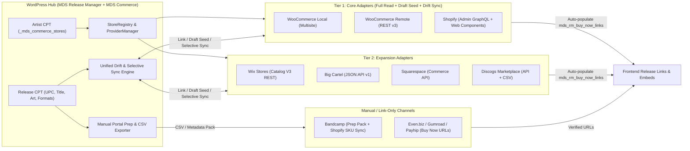

# Commerce Platforms for Artists & Independent Labels — Ecosystem Feasibility & Migration Study

**Topic:** `commerce-platforms`  
**Scope:** Repurposing `mds-woocommerce` (`2.0.0`) into **`mds-commerce`** as a multi-platform commerce companion for `MDS Release Manager` (`MDS_RM_API_VERSION = 2.0.0+`).  
**Target Audience:** Solo indie artists (zero/low budget), boutique record labels (Bandcamp + Shopify/WooCommerce), and multi-artist label networks running WordPress Multisite Hub-and-Spoke catalogs.  
**Date:** 2026-11-26

---

## 1. Context & Strategic Objective

Currently, `mds-woocommerce` provides deep, tightly coupled WooCommerce Multisite integration:
- **Per-Artist Store Scoping:** `_mds_wc_target_stores` restricts which WooCommerce spoke sites receive releases for each artist.
- **Release-to-Product Linking & Seeding:** `_mds_linked_products` and `_mds_local_product_id` link Hub releases to Spoke WooCommerce products, with one-click Draft seeding (`POST /generate`).
- **Drift Detection & Selective Sync:** `ProductDrift` compares UPC/GTIN, SKU, Cover Art, and Title and pushes admin-approved updates (`POST /sync-product`).
- **Frontend Context & Injection:** `mds_rm_release_context_post` and `mds_wc_product_injection` inject MDS blocks onto WooCommerce Single Product pages.

However, real-world artists and independent labels rarely run *only* WooCommerce. Many artists already operate **Shopify** (especially paired with **Single.xyz** for Billboard/OCC chart reporting), **Wix**, **Bandcamp**, **Big Cartel**, **Squarespace**, **Fourthwall**, or **Discogs Marketplace** for physical vinyl/CD stock.

Repurposing `mds-woocommerce` into **`mds-commerce`** turns WordPress (`MDS Release Manager`) into the **Single Source of Truth (SSOT)** for release metadata, UPC/EAN barcodes, artwork, and Buy Now links—while delegating storefront operations to pluggable **Commerce Providers**.

---

## 2. Ecosystem Discovery (Inbound, Outbound, and Manual Prep)

### A. Inbound (Read / Consume)
- **Catalog Search & Link:** Pull existing products, variants (LP / CD / Cassette / Digital), prices, SKUs, GTIN/UPC barcodes, stock status, and public storefront URLs from connected stores to link against MDS `release` posts.
- **Drift Inspection:** Compare remote product title, UPC/barcode, SKU, and cover art against the Hub Release without overwriting store-specific pricing or descriptions.
- **Buy Now Auto-Sync:** Automatically feed verified storefront URLs and stock status (`InStock` / `OutOfStock` / `PreOrder`) into `mds_rm_buy_now_links` so frontend `[release-links]` blocks stay accurate without manual URL pasting.

### B. Outbound (Push / Seed / Publish)
- **Product Seeding (Draft-First):** Create draft products (and format variants) on **WooCommerce** (local Multisite or remote REST v3), **Shopify** (Admin GraphQL API), **Wix Stores** (Catalog V3 REST API), **Big Cartel** (JSON:API v1), **Squarespace** (Commerce Products API), and **Fourthwall** (Open API).
- **Selective Drift Sync:** Push only admin-approved fields (Title, UPC/GTIN, SKU, Cover Art) using platform-safe concurrency controls (e.g., Wix `revision` integers, Shopify GraphQL mutations, WooCommerce lookup table updates).
- **Frontend Embeds:** Render native checkout experiences on WordPress release pages via **Shopify Storefront Web Components / Buy Button** or **SureCart** blocks alongside standard outbound Buy Now buttons.

### C. Manual-Portal Automation (Prep Only)
- **Bandcamp (Artist/Label Portal):** Bandcamp intentionally blocks public product-creation APIs (its OAuth API is gated to approved fulfillment partners and label sales reporting). However, WordPress can:
  1. Generate **Bandcamp-ready release prep packs** (high-res square cover art, formatted tracklist/liner notes, publishing rights / ISWC credits added in Bandcamp's 2026 update, and SKU mapping tables).
  2. Leverage **Bandcamp Sync for Shopify** indirectly: when `mds-commerce` maintains consistent SKUs in Shopify, Bandcamp Pro/Label's official Shopify sync mirrors inventory automatically.
- **Discogs Marketplace (Bulk Inventory):** While Discogs has a 60 req/min API, bulk label inventory is far faster via its **10 MB CSV Importer** (`release_id`, `price`, `media_condition`, `sleeve_condition`, `status`). `mds-commerce` can export Discogs-compliant CSVs directly from MDS Releases.
- **Even.biz / Gumroad / Payhip:** Export formatted metadata/copy packs and link storefront URLs into `mds_rm_buy_now_links` without brittle scraping.

---

## 3. Feasibility Scoring Matrix

| Platform / Provider | Direction | Founded (Age) | Popularity & Adoption | Cost / Tiers | Rate Limits & Telemetry | Longevity Outlook (5–10 yr) | WP Implementation Effort | Verdict |
| :--- | :--- | :--- | :--- | :--- | :--- | :--- | :--- | :--- |
| **WooCommerce (Local Multisite)** | Read + Push + Inject | 2011 (15 yrs) | #1 WP ecommerce (~35%+ of WP stores); Automattic-backed | Free core (GPL); 0% platform fee | Zero HTTP limits (native PHP/SQL); Multisite blog-switch cost | **Very High** — Core WP ecosystem pillar | **Low** (Already built; refactor into Adapter) | **Build Now (Tier 1)** |
| **WooCommerce (Remote REST v3)** | Read + Push | 2011 (15 yrs) | Same as above; enables standalone artist WP stores outside Multisite | Free core; Consumer Key/Secret over HTTPS | Host-dependent; standard WP REST headers | **Very High** — Stable v3 REST API | **Low** (1–2 days) | **Build Now (Tier 1)** |
| **Shopify (Admin GraphQL + Storefront Web Components)** | Read + Push + Embed | 2006 (20 yrs) | #1 SaaS ecommerce for indie labels & merch; powers Single.xyz chart reporting | Basic ~$39/mo, Grow ~$105/mo, Adv ~$399/mo; Custom App free on store | **GraphQL only** (REST deprecated Apr 2025). Leaky bucket: 100 pts/s (Basic), 200 (Adv), 1,000 (Plus); 1,000 pt max/query; `extensions.cost` telemetry; Bulk Ops `.jsonl` for large catalogs | **Very High** — Profitable public market leader | **Medium** (4–5 days) | **Build Now (Tier 1)** |
| **Wix Stores (Catalog V3 REST API)** | Read + Push | 2006 (20 yrs) | Huge DIY artist/band website share; strong visual builder | Core/Business ~$29–$36/mo+ for ecommerce | HTTP `429` with `X-RateLimit-Limit`, `X-RateLimit-Remaining`, `Retry-After`; requires `revision` int on `PATCH`; full-array overwrite on variants; `/bulk/products/update` up to 100 items | **High** — Public profitable SaaS; active v3 Catalog API | **Medium** (4–5 days) | **Build Next (Tier 2)** |
| **Big Cartel (API v1 JSON:API)** | Read + Push | 2005 (21 yrs) | Cult favorite among indie musicians, punk/DIY labels, visual artists | Gold Free (5 items), Platinum $15/mo (50), Diamond $30/mo (500); **0% platform fee** | No hard rate limit published; recommends OAuth2 Webhooks (`account.*`, `product.*`); `application/vnd.api+json` | **High** — Profitable, independent, 20+ yr track record | **Low–Medium** (2–3 days) | **Build Next (Tier 2)** |
| **Bandcamp (Prep + Official Partner API)** | Prep Only (Read/Orders for approved labels) | 2008 (18 yrs) | #1 indie music D2C marketplace; ~90% physical / ~85% digital artist share | Free to start (10% physical, 15% digital rev share); Pro/Label paid tiers | **No public create-product API**; OAuth2 gated to approved labels/fulfillment partners; no webhooks (polling only) | **Medium–High** — Owned by Songtradr (moved to Stripe 2025–26; strong human-artist brand, but corporate shifts warrant caution) | **Low** (1–2 days for Prep/CSV + URL Linker; Partner API optional) | **Prep / Export Only (Tier 2)** |
| **Squarespace Commerce (REST API)** | Read + Push | 2003 (23 yrs) | Very popular for musician EPKs and boutique label sites | Basic ~$19–$25/mo (2% fee); Core ~$29–$39/mo (0%); Advanced ~$99+/mo (full API keys) | **300 req/min** (5 req/s), 1-min cooldown on `429`; strict `User-Agent` required; max 6 options / 250 variants; no headless checkout API | **High** — Mature private/large SaaS; API restricted on lower plans | **Medium** (3–4 days) | **Build Next (Tier 2)** |
| **Discogs Marketplace (API + CSV)** | Read + Push / Prep CSV | 2000 (26 yrs) | Essential vinyl/CD/cassette collector marketplace for labels | Free to list; ~9% seller fee | **60 req/min** auth (25 unauth); `X-Discogs-Ratelimit-*` headers; 10 MB CSV upload (up to 1 hr processing) | **High** — Irreplaceable music database & physical marketplace | **Low–Medium** (2–3 days) | **Build Next / Prep CSV (Tier 2)** |
| **Fourthwall (Open API)** | Read + Push | 2019 (7 yrs) | Fast-growing creator/musician merch & memberships platform | $0/mo base (5% fee on digital/memberships; 0% on merch margin) | **100 req / 10s** general; **5 req/min** `POST /products`; **20 req/min** media upload; `429 OPEN_API_TOO_MANY_REQUESTS` | **Medium–High** — Strong creator momentum, newer VC-backed company | **Medium** (3–4 days) | **Optional Provider (Tier 3)** |
| **Printful (API v2)** | Push / POD Merch | 2013 (13 yrs) | Leading print-on-demand merch supplier (apparel, posters, totes) | $0/mo Free (pay per order); Growth $24.99/mo (waived at $12k/yr) | **120 req/min** general; **10 req/min** sync product writes; 60s lockout on `429` | **High** — Established POD leader | **Medium–High** (5+ days due to mockup/print placement complexity) | **Optional Provider (Tier 3)** |
| **SureCart / EDD (WP-Native)** | Read + Push (Local WP) | EDD 2012 (14 yrs) / SureCart 2022 (4 yrs) | Top lightweight WooCommerce alternatives for digital music downloads | Freemium / Annual license | Local WP PHP or SureCart cloud REST API | **High** (EDD) / **Medium–High** (SureCart) | **Low–Medium** (2–3 days) | **Optional Provider (Tier 3)** |
| **Single.xyz / Even.biz** | Companion / Link Only | Single 2016 / Even 2022 | Music-specific chart reporting (Single on Shopify) & mobile drops (Even) | Paid / Rev-share | Single sits *inside* Shopify (inherits Shopify product catalog); Even has no open public catalog write API | **Medium** — Niche music SaaS | **Low** (URL/Link support only) | **Prep / Link Only** |

---

## 4. Architecture: WordPress as Single Source of Truth (SSOT)

### Tiered Budget Strategy
- **Zero-Budget Indie Artist ($0/mo software cost):**
  - Uses **WooCommerce Local** (free), **Big Cartel Gold** (free, up to 5 products, 0% fee), **Bandcamp Prep Pack** (free), and **Discogs CSV Export** (free).
  - Zero paid API keys required.
- **Growing Indie Artist / Boutique Label ($15–$50/mo):**
  - Connects **Shopify Basic** (with Custom App token) or **Wix / Squarespace / Big Cartel Platinum**, syncing UPCs, cover art, and Buy Now links straight from WordPress.
  - Pairs Shopify SKUs with **Bandcamp Sync for Shopify** for automated physical stock mirroring.
- **Scaling Record Label / Multi-Artist Network ($100+/mo):**
  - Mixes **Multisite WooCommerce Spokes**, **Artist-owned Shopify/Wix stores**, and **Shopify + Single.xyz** for Billboard/OCC chart-eligible D2C drops—all governed by per-artist Store Scoping on the Hub.

### Lock-In, Rate-Limit Cooldown & Failover Risks
1. **Shopify REST Sunset:** Never build against Shopify REST Admin API. Build exclusively on **Admin GraphQL API** (versioned quarterly, e.g., `2026-01`+) and read `extensions.cost.throttleStatus.currentlyAvailable` before issuing queued calls.
2. **Wix Revision & Variant Safety:** Always fetch the latest product `revision` immediately before `PATCH`, and never send partial `variantsInfo.variants` arrays (Wix V3 wipes omitted variants).
3. **Cooldown Circuit Breaker:** Store per-store cooldown timestamps in transients (`mds_cm_cooldown_{store_key}`) whenever HTTP `429` or `Retry-After` is returned; surface a non-blocking admin notice rather than failing the whole Release save.
4. **Raw Payload Caching:** Cache remote product snapshots locally in a short-TTL transient (or post meta snapshot) so opening the Release Editor never blocks on synchronous remote HTTP calls to 5 different APIs.

---

## 5. Concrete Migration Path: `mds-woocommerce` → `mds-commerce`

To evolve `mds-woocommerce` (`2.0.0`) into `mds-commerce` (`1.0.0` or `3.0.0`) with **zero data loss** for existing WooCommerce Multisite installations:

### Phase 0: Naming, Package & Repository Identity
| Token | Current (`mds-woocommerce`) | Target (`mds-commerce`) |
| :--- | :--- | :--- |
| **Plugin Slug / Folder** | `mds-woocommerce` | `mds-commerce` |
| **Plugin Name** | `MDS WooCommerce Integration` | `MDS Commerce` |
| **Text Domain** | `mds-woocommerce` | `mds-commerce` |
| **PHP Namespace** | `MDS\WooCommerce\` | `MDS\Commerce\` |
| **Constant / Hook Prefix** | `MDS_WC_` / `mds_wc_` | `MDS_CM_` / `mds_cm_` |
| **REST Namespace** | `mds-wc/v1` (alias `mds-woo/v1`) | `mds-commerce/v1` (legacy aliases `mds-wc/v1`, `mds-woo/v1` kept for 1 major cycle) |

### Phase 1: Provider Abstraction & Data Schema Upgrade (Zero-Loss)
1. **Introduce `StoreKey` Value Object:** Replace raw integer `$blog_id` store keys with namespaced string keys:
   - Local Multisite WooCommerce: `wc_local:{blog_id}` (e.g., `wc_local:3`)
   - Remote WooCommerce: `wc_remote:{connection_id}`
   - Shopify: `shopify:{connection_id}`
   - Wix: `wix:{connection_id}`
   - Big Cartel: `bigcartel:{connection_id}`
2. **Introduce `CommerceProviderInterface`:**
   - `get_slug(): string`, `get_label(): string`, `get_capabilities(): array` (`search`, `link`, `seed_draft`, `sync_drift`, `frontend_inject`, `embed_checkout`)
   - `test_connection( StoreConnection $store ): bool|WP_Error`
   - `search_products( StoreConnection $store, string $query, int $page = 1 ): array`
   - `get_product( StoreConnection $store, string $remote_id ): ?NormalizedProduct`
   - `create_draft_product( StoreConnection $store, ReleasePayload $release, array $options = [] ): NormalizedProduct|WP_Error`
   - `sync_fields( StoreConnection $store, string $remote_id, array $fields ): NormalizedProduct|WP_Error`
3. **One-Time Idempotent Data Migration (`UpgradeRoutine`):**
   - Read legacy `_mds_wc_target_stores` (array of `int` blog IDs) on Hub Artists → migrate to `_mds_commerce_target_stores` (`['wc_local:3', 'wc_local:5']`) while keeping read-fallback if not yet migrated.
   - Read legacy `_mds_linked_products` (keyed by `int` blog ID) on Hub Releases → migrate to `_mds_commerce_links` (keyed by `StoreKey`, storing `remote_id`, `permalink`, `sku`, `upc`, `status`, `last_synced_gmt`, `provider`).
   - Preserve `_mds_local_product_id` on Spoke shadow releases unchanged so `mds_rm_release_context_post` and Single Product Page Injection keep working with zero interruption.
   - Copy `mds_wc_product_injection` → `mds_cm_wc_product_injection` (retaining read fallback).
4. **WooCommerce Adapter First:** Extract existing `StoreRegistry`, `ProductDrift`, `ReleaseMeta`, and `SiteSettings` into `src/Providers/WooCommerceLocal/` so 100% of current functionality works identically under the new architecture before adding remote providers.

### Phase 2: Remote Store Connection Manager & Tier 1 Providers
- Build **Network/Site Store Connections UI** (under Release Manager settings tab) where admins add external stores (Shopify, Remote WooCommerce) with encrypted credentials (`wp-config.php` constant override supported).
- Ship **Shopify Provider** (Admin GraphQL API: search, link, draft create, selective drift sync for title/SKU/barcode/image + optional Storefront Web Components embed block).
- Ship **Remote WooCommerce Provider** (WC REST API v3 over HTTPS) for artists whose WP store is hosted separately from the label's Multisite Hub.
- Hook `mds_rm_buy_now_links` so linked store products can optionally auto-populate Release Buy Now links.

### Phase 3: Tier 2 Expansion Providers & Manual Prep
- Add **Wix Stores (Catalog V3)**, **Big Cartel (JSON:API v1)**, and **Squarespace Commerce** adapters.
- Add **Bandcamp Prep Pack** (downloadable metadata/copy/artwork bundle + SKU crosswalk) and **Discogs Marketplace CSV Exporter**.

---

## 6. Prioritized Roadmap & Open Questions

### Roadmap Summary
- **Tier 1 (Core Refactor + Launch):** `mds-woocommerce` → `mds-commerce` refactor, `CommerceProviderInterface`, `WooCommerceLocal` (migrated), `WooCommerceRemote` (REST v3), `Shopify` (Admin GraphQL).
- **Tier 2 (Indie Artist & Label Expansion):** `Wix Stores` (V3), `Big Cartel`, `Squarespace`, `Bandcamp Prep Pack`, `Discogs CSV Export`.
- **Tier 3 (Optional / On-Demand):** `Fourthwall`, `Printful` (POD), `SureCart` / `EDD`.

### Open Questions for Sign-Off
1. **Repo & Plugin Replacement Strategy:** Do you want to **rename** the existing `mds-woocommerce` repo/folder in place (so git history is preserved and `mds-woocommerce` becomes `mds-commerce` v3.0.0), or create a brand-new `mds-commerce` repo that detects and migrates data from an active/inactive `mds-woocommerce` installation?
2. **Multi-Format Variant Mapping:** When seeding a Release that has multiple formats (e.g., Vinyl LP, CD, Digital), should `mds-commerce` default to **one product with format variants** (best for Shopify/Wix/Big Cartel) or **one product per format** (common in WooCommerce/Discogs), or make it selectable in the Create modal?
3. **Auto-Populating `Buy Now` Links:** Should linking a Shopify/Wix/WooCommerce product automatically inject its URL into `mds_rm_buy_now_links` (with a per-link toggle), or remain strictly opt-in?
