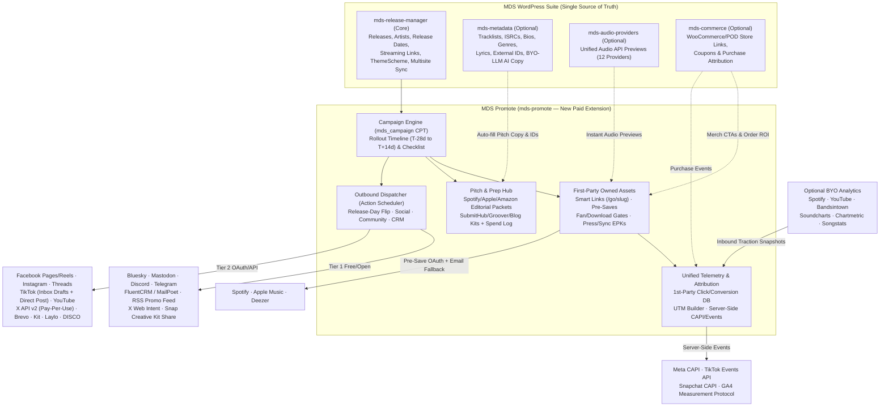

# Music Promotion Ecosystem & Plugin Feasibility Study

**Topic:** `music-promotion`  
**Target Plugin:** New Paid Extension in the MDS WordPress Suite — Proposed Name: **`MDS Promote`** (`mds-promote`)  
**Audience:** All types of music creators — solo indie artists, bands, beatmakers/producers, electronic artists/DJs, sync composers, and multi-artist record labels (single-site and Multisite Hub-and-Spoke)  
**Date:** November 2026  
**Status:** Read-Only Feasibility Research (`wp-research`)

---

## 1. Executive Summary & Core Strategic Findings

Modern music promotion is fragmented across 5–10 disconnected SaaS subscriptions (smart links, pre-saves, playlist pitching, social schedulers, fan CRMs, EPK hosts, and analytics dashboards) that routinely cost creators \$50–\$300+/month and trap their first-party fan data on third-party domains.

Our ecosystem audit reveals **four decisive realities** that shape how MDS should build this plugin:

1. **Curator & Playlist Pitching Portals Have Zero Public Write APIs:** SubmitHub, Groover, Musosoup, PlaylistPush, DailyPlaylists, Spotify for Artists, Apple Music Connect, and Amazon Music for Artists intentionally block public submission APIs to prevent bot spam and protect DSP terms of service. The winning WordPress pattern is **Campaign Prep, Timeline Enforcement, and Pitch Packet Automation**—not brittle scraping.
2. **WordPress Is a Superior First-Party Smart Link, Pre-Save, Fan-Gate & EPK Host:** Hosting Smart Links (`/go/{slug}`), Pre-Save pages, Fan/Download Gates, and Electronic Press Kits (EPKs) directly on the creator's own WordPress domain eliminates SaaS link taxes (Linkfire/Feature.fm/Hypeddit), enables **first-party cookies** (recovering 20–40% of lost ad attribution via Meta CAPI, TikTok Events API, and GA4 Measurement Protocol), and inherits `mds-release-manager`'s `ThemeScheme` automatically.
3. **Open Social & Community Protocols Provide Free, Zero-Gate Distribution:** Bluesky (AT Protocol), Mastodon (ActivityPub), Discord Webhooks, Telegram Bot API, and WordPress-native CRMs (FluentCRM/MailPoet) allow instant, zero-cost, zero-app-review campaign launches on Day 1. Meanwhile, high-reach gated APIs (Meta/Instagram/Threads, YouTube Data API v3, TikTok Content Posting API, Laylo, Brevo, Kit, DISCO) can be plugged in via modular OAuth/API providers.
4. **The MDS Suite Creates an Unfair Architectural Advantage:** Unlike standalone SaaS tools, `MDS Promote` sits directly on top of the creator's canonical catalog (`mds-release-manager`), enriched metadata/lyrics/AI copy (`mds-metadata`), playable previews (`mds-audio-providers`), and merch/vinyl/beat checkout (`mds-commerce`)—enabling true end-to-end **Maintain → Launch → Track** campaigns from a single WordPress dashboard.

---

## 2. Proposed Plugin Name & Identity

Following the MDS suite's crisp, modular naming convention (`MDS Release Manager`, `MDS Audio Providers`, `MDS Metadata`, `MDS Commerce`, `MDS Page Builders`, `MDS Licensing`):

| Candidate | Slug | Namespace / Prefix | Fit & Positioning |
| :--- | :--- | :--- | :--- |
| **`MDS Promote`** *(Recommended)* | `mds-promote` | `MDS\Promote\` / `MDS_PR_` / `mds_pr_` | Short, punchy, action-oriented, immediately clear to solo artists, beatmakers, composers, and labels alike. Pairs naturally with `MDS Commerce` and `MDS Metadata`. |
| **`MDS Campaigns`** *(Runner-Up)* | `mds-campaigns` | `MDS\Campaigns\` / `MDS_CP_` / `mds_cp_` | Strong noun-alignment with the central Campaign workspace (release rollouts, tours, drops), though slightly narrower than general promotion/EPKs/smart links. |
| **`MDS Promotion`** *(Formal Option)* | `mds-promotion` | `MDS\Promotion\` / `MDS_PM_` / `mds_pm_` | Strictly noun-based like `MDS Commerce`, slightly more enterprise/label-toned. |
| **`MDS Amplify`** *(Brand Option)* | `mds-amplify` | `MDS\Amplify\` / `MDS_AM_` / `mds_am_` | Memorable music-themed brand name, but less immediately self-explanatory in the WordPress Plugins list than `MDS Promote`. |

- **Tier Placement (per `mds-product-tiers.md`):** **Paid Extension** (external API integrations, social/email/ad publishing, pre-save OAuth, server-side CAPI/Events tracking, and campaign analytics never belong in `mds-release-manager` Free Core).
- **Licensing (per `mds-company-branding-licensing.md`):** Dual/Split model (`GPL-3.0-or-later` PHP WordPress integration + `COMMERCIAL-LICENSE.md` from Walton International Business Group LLC / Musty Dungeon Studios), using the official MDS SVG icon (`ExtensionApi::get_brand_icon_svg()`).

---

## 3. Broad Ecosystem Discovery (Consume, Push, and Prep)

### A. Creator-Type Coverage Matrix

| Creator Archetype | Primary Promotion Channels | Key `MDS Promote` Workflows |
| :--- | :--- | :--- |
| **Solo Indie Artists & Bands** | Smart Links, Pre-Saves, Spotify/Apple/Amazon Editorial Pitch, SubmitHub/Groover, Instagram/TikTok/YouTube, Email/SMS, Bandsintown/Songkick | Full Release Rollout Timeline, Smart Link + Pre-Save, Editorial Pitch Packets, Social/Email Launch, Tour Date Widget |
| **Beatmakers & Producers** | YouTube Type-Beat Uploads, TikTok/IG Reels, Discord/Telegram Drop Alerts, Download/Fan Gates, BeatStars/WooCommerce Checkout | Fan/Download Gates (Follow/Email → Free Tagged Beat/Stems), YouTube/Social Teaser Push, `mds-commerce` License Attribution |
| **Electronic Artists & DJs** | SoundCloud/RepostExchange, Hypeddit-style Fan Gates, Bandcamp, Mixcloud, Discord/Telegram, TikTok/IG Reels | Self-Hosted Fan Gates (Spotify/SoundCloud/Email unlock), Pre-Save, Club/Promo Pool EPKs |
| **Sync Composers & Instrumentalists** | DISCO (`disco.ac`), Private Password-Protected EPKs, Metadata/Stem Pitch Sheets, LinkedIn/Email Outreach | Private Tracked EPK Links (play/download tracking), DISCO Catalog Sync, One-Sheet Pitch Exports |
| **Indie Record Labels & Managers** | Multi-Artist Multisite Rollouts, Linkfire/Feature.fm parity, Meta CAPI / TikTok Events Ads, Soundcharts/Chartmetric/Songstats ROI | Hub-and-Spoke Multi-Artist Campaign Calendar, Server-Side Ad Attribution, Roster Analytics & Pitch Spend Tracker |

---

### B. Feasibility Scoring Matrix

#### 1. First-Party Owned Channels & Pre-Save / Smart Link APIs

| Platform / Protocol | Direction | Founded (Age) | Popularity & Adoption | Cost / Tiers | Rate Limits & Telemetry | Longevity (5–10 yr) | WP Effort | Verdict |
| :--- | :--- | :--- | :--- | :--- | :--- | :--- | :--- | :--- |
| **Self-Hosted MDS Smart Links, Fan Gates & EPKs** | `Publish` / `Read` (1st-party) | Native WP | Universal (replaces Linkfire/Feature.fm/Hypeddit) | \$0 ongoing SaaS fees | Unlimited (site-hosted; lightweight custom DB table) | **Very High** (owned on creator's domain) | Medium (3–5d) | **Build Now** |
| **Spotify Web API (Pre-Save OAuth & Track Metrics)** | `Push` / `Read` | 2006 (20 yr) | Dominant global DSP (~31% share) | Free Developer App; **Note:** Dev Mode capped at 5 allowlisted users; Extended Quota requires Spotify review | Dynamic rolling window + `429 Retry-After`; `user-library-modify` scope | **Very High** (market leader, stricter API gating) | Medium (3–5d) | **Build Now** (with Email-Alert fallback for Dev Mode) |
| **Apple Music API / MusicKit JS (Pre-Add)** | `Push` / `Read` | 2015 (11 yr) | #2 global DSP | Requires \$99/yr Apple Developer account (ES256 JWT + Music User Token) | Standard Apple Media Services quotas; distributor pre-order required for pre-add | **Very High** | Medium (3–5d) | **Build Next** |
| **Deezer Connect OAuth API (Pre-Save)** | `Push` / `Read` | 2007 (19 yr) | Major EU/LATAM DSP | Free developer app (`manage_library`) | ~50 req / 5 sec | **High** | Low (1–2d) | **Build Next** |
| **Linkfire API** | `Push` / `Read` | 2014 (12 yr) | Major-label smart link standard | No free tier; Pro ~\$21–27/mo, Teams ~\$45–55/mo, API Enterprise custom | OAuth2 + Webhooks; OpenAPI spec | **High** (profitable SaaS) | Medium (3–5d) | **Optional Paid Provider** |
| **Feature.fm API** | `Push` / `Read` | 2014 (12 yr) | Top indie/label smart link & pre-save tool | Free tier; Paid \$8–\$39/mo; full Partner API enterprise-gated | Partner API quotas | **High** | Medium (3–5d) | **Optional Paid Provider** |
| **Hypeddit / Show.co / SymphonyOS** | `Prep Only` | 2014–2021 | Popular indie fan gates & AI ad tools | \$9–\$49+/mo; Hypeddit/Show.co lack public APIs; SymphonyOS OpenAPI is enterprise-focused | N/A | **Medium** (crowded indie SaaS) | Low (1–2d) | **Skip** (replace core value with Self-Hosted Smart Links & Fan Gates) |

#### 2. Social, Video & Community Publishing Channels

| Platform / Protocol | Direction | Founded (Age) | Popularity & Adoption | Cost / Tiers | Rate Limits & Telemetry | Longevity (5–10 yr) | WP Effort | Verdict |
| :--- | :--- | :--- | :--- | :--- | :--- | :--- | :--- | :--- |
| **Bluesky (AT Protocol)** | `Publish` | 2021 (5 yr) | Fast-growing indie artist/music community | **Free**, open protocol, App Passwords / OAuth, zero app review | ~1,666 posts/hr (11,666/day); 300 graphemes, 4 images or 1 video; requires byte-offset URL facets | **High** (open protocol) | Low (1–2d) | **Build Now** |
| **Mastodon / ActivityPub** | `Publish` | 2016 (10 yr) | Strong indie/electronic/open-web music pods | **Free**, open standard, OAuth per instance | ~300 statuses / 3h; 300 req / 5m; instance-dependent char limits | **Very High** (federated W3C standard) | Low (1–2d) | **Build Now** |
| **Discord Webhooks** | `Publish` | 2015 (11 yr) | #1 community hub for producers, electronic, indie superfans | **Free**, zero OAuth review (paste webhook URL) | 5 req / 2 sec per webhook (`429 retry_after`); rich embeds + 25 MB uploads | **Very High** | Low (1–2d) | **Build Now** |
| **Telegram Bot API** | `Publish` | 2013 (13 yr) | Huge direct-to-fan drop channels globally | **Free**, instant BotFather token | 1 msg/sec per chat, 20/min per group, 30/sec global; 50 MB media | **Very High** | Low (1–2d) | **Build Now** |
| **YouTube Data API v3** | `Publish` / `Read` | 2005 (21 yr) | #1 global music discovery & Shorts platform | **Free** (Google Cloud OAuth2; compliance audit for higher quota) | Dedicated `videos.insert` bucket: **100 uploads/day**; 10,000 general units/day | **Very High** | Medium (3–5d) | **Build Next** |
| **Facebook Pages Graph API** | `Publish` / `Read` | 2004 (22 yr) | Massive reach for bands, live venues, legacy & global fanbases | **Free** API; requires Meta App Review + Page permissions (`pages_manage_posts`, `pages_read_engagement`) | **30 Reels/24h** (`video_reels`), ~25 standard posts/day; Video/Reels Insights (`total_reels_plays`, `reels_replays`); `X-Business-Use-Case-Usage` throttling | **Very High** | Medium (3–5d) | **Build Next** |
| **Instagram Graph API (Meta)** | `Publish` / `Read` | 2010 (16 yr) | Essential visual/Reels music promo channel | **Free** API; requires IG Professional account + Meta App Review & Business Verification | **100 API-published posts / 24h**; general calls `4800 × Impressions / 24h` | **Very High** | High (1–2w) | **Build Next** |
| **Meta Threads API** | `Publish` | 2023 (3 yr) | High-growth text/media music promo | **Free** API; requires Meta App Review + 60-day token refresh | 250 posts/24h, 1,000 replies/24h | **High** | Medium (3–5d) | **Build Next** |
| **TikTok Content Posting & Display API** | `Publish` / `Read` | 2016 (10 yr) | #1 viral music discovery engine | **Free** API; unaudited apps locked to `SELF_ONLY` (private) until TikTok App Audit | 6 upload starts/min; ~15 posts/day; supports **MP4/MOV Video** + **Photo Mode Carousels** (up to 35 JPEG/WebP). **Music nuance:** Use `video.upload` (Inbox Draft) so artists can attach official distributed TikTok Sounds natively, or `video.publish` (Direct Post) for original audio. | **High** (regulatory volatility, huge reach) | High (1–2w) | **Build Next** (Inbox Draft + Photo Mode first, Direct Post post-audit) |
| **X (Twitter) API v2** | `Publish` / `Read` | 2006 (20 yr) | Real-time music news, hip-hop/pop/indie fandoms, press & radio | **No permanent free tier**; pay-per-use credits: **\$0.015/text post**, **\$0.20/post with URL**, \$0.005/post read | 100 posts / 15m per user; 10,000 / 24h per app; media upload via auxiliary endpoint | **High** (pricing volatility) | Low (1–2d) | **Optional Paid Provider** (+ Free 1-Click Web Intent fallback) |
| **Snapchat (Creative Kit + Marketing API)** | `Prep` / `Share` / `Ads` | 2011 (15 yr) | Major Gen-Z / hip-hop / pop discovery & fan sharing | **No public organic auto-posting API** (Public Profile API is strictly partner-gated). **Creative Kit** (1-click share-to-Snap) & **Marketing API** are free to integrate | Marketing API: **20 req/s** app-wide, **10 req/s** per token (`429` exponential backoff); no organic posting endpoints | **High** (for ads & fan-share stickers) | Low–Med (2–4d) | **Build Next** (Snap CAPI + Creative Kit Share + 9:16 Story/Spotlight Prep) |
| **Reddit API** | `Prep Only` | 2005 (21 yr) | High-value niche genre discovery | Free 100 QPM OAuth, but strict anti-self-promo subreddit rules (9:1 ratio) & commercial API restrictions | 100 QPM; high shadowban risk on automated posting | **High** (platform), **Low** (for auto-posting) | Low (1–2d) | **Prep / Export Only** (generate formatted post drafts, never auto-spam) |

#### 3. Email, SMS, Fan CRM & Live/Sync Outreach

| Platform / Protocol | Direction | Founded (Age) | Popularity & Adoption | Cost / Tiers | Rate Limits & Telemetry | Longevity (5–10 yr) | WP Effort | Verdict |
| :--- | :--- | :--- | :--- | :--- | :--- | :--- | :--- | :--- |
| **FluentCRM / MailPoet (Native WP CRMs)** | `Push` / `Read` | 2011–2020 | Top self-hosted WordPress fan list tools | Flat annual WP license (~\$77–\$129/yr) + cheap SES/SMTP; no per-subscriber tax | Local PHP hooks / WP REST API (no external throttle) | **Very High** | Low (1–2d) | **Build Now** |
| **Brevo (ex-Sendinblue) API** | `Push` | 2012 (14 yr) | Ideal for musicians with large, infrequent fan lists + SMS | Free 300 emails/day; volume-based paid tiers + built-in SMS | REST API v3; generous burst limits | **High** | Low (1–2d) | **Build Now** |
| **Kit (ex-ConvertKit) API** | `Push` | 2013 (13 yr) | Leading indie creator newsletter platform | Free up to 10k subs (limited); paid creator tiers | REST API v4; 120 req/min | **High** | Low (1–2d) | **Build Next** |
| **Mailchimp API** | `Push` | 2001 (25 yr) | Legacy market leader | Free up to 500 contacts; expensive per-contact scaling | Marketing API v3; 10 concurrent connections | **High** | Low (1–2d) | **Build Next** |
| **Laylo GraphQL API** | `Push` | 2019 (7 yr) | #1 music "drop" SMS/IG-DM/WhatsApp fan alert tool | Free starter; paid Pro/Label tiers + SMS messaging | GraphQL (`laylo.com/api/graphql`), `subscribeToUser` mutation | **High** (strong music adoption) | Low (1–2d) | **Build Next** |
| **Bandsintown API** | `Read` | 2007 (19 yr) | #1 live concert discovery network | Free `app_id` REST API for artist events & ticket CTAs | Standard REST limits; cached 6–12h | **High** | Low (1–2d) | **Build Next** |
| **DISCO (`disco.ac`) API** | `Push` / `Read` | 2016 (10 yr) | Industry standard for sync licensing & music supervisors | Paid DISCO plans; `X-Disco-API-Key` REST API | Standard REST quotas | **High** (entrenched sync standard) | Medium (3–5d) | **Optional Paid Provider** |
| **Songkick API** | `Read` | 2007 (19 yr) | #2 concert discovery platform | Free key (strict/slow developer onboarding) | Standard REST limits | **Medium** (key approval friction) | Low (1–2d) | **Prep / Embed Fallback** |

#### 4. Editorial Pitching, Curator Marketplaces & Press (Manual-Portal Prep)

| Platform / Portal | Direction | Founded (Age) | Popularity & Adoption | Cost / Tiers | API Status & Automation Rule | Longevity (5–10 yr) | WP Effort | Verdict |
| :--- | :--- | :--- | :--- | :--- | :--- | :--- | :--- | :--- |
| **Spotify for Artists (Editorial Pitch)** | `Prep Only` | 2017 (9 yr) | Mandatory for Release Radar & Editorial Playlists | Free | **No write API.** Hard minimum **7 days** before release (2–4 weeks recommended); 1 track/release. | **Very High** | Low (1–2d) | **Build Now** (Countdown + Pitch Packet + Checklist) |
| **Apple Music Pitch (Connect / Distributor)** | `Prep Only` | 2015 (11 yr) | Essential Apple editorial pipeline | Free via distributor | **No write API.** Target **10+ days** prior; prioritizes Atmos, synced lyrics (`mds-metadata`), animated art. | **Very High** | Low (1–2d) | **Build Now** (Countdown + Pitch Packet) |
| **Amazon Music for Artists** | `Prep Only` | 2019 (7 yr) | Growing streaming & Alexa voice discovery | Free | **No write API.** Unique window: **7+ days pre-release up to 14 days post-release**. | **Very High** | Low (1–2d) | **Build Now** (Countdown + Post-Release Reminder) |
| **SubmitHub / Groover / Musosoup / PlaylistPush / DailyPlaylists** | `Prep Only` | 2015–2020 | Top indie curator, blog & playlist marketplaces | Free credits to \$2–\$300+/campaign | **Zero public write APIs** (anti-fraud & DSP ToS). WordPress generates pitch packets, private EPK/stream links, UTM Smart Links, and logs campaign spend/outcomes. | **High** (as a category) | Low (1–2d) | **Prep / Export Only** (Pitch Kit + Spend/ROI Tracker) |
| **Hype Machine / Music Blogs** | `Publish` (RSS) / `Prep` | 2005 (21 yr) | Iconic indie music blog aggregator | Free | Indexes music blogs via RSS/feeds; WP generates Press Release + MP3/Stream Embeds + RSS promo feed. | **Medium** | Low (1–2d) | **Prep / Export Only** |
| **RepostExchange (SoundCloud)** | `Prep Only` | 2015 (11 yr) | Official SoundCloud organic promo network | Free / Paid credits | No public API; track campaign links & SoundCloud growth in MDS Promote. | **Medium** | Low (1–2d) | **Prep / Export Only** |

#### 5. Attribution, Server-Side Ad Pixels & Cross-Platform Analytics

| Platform / API | Direction | Founded (Age) | Popularity & Adoption | Cost / Tiers | Rate Limits & Telemetry | Longevity (5–10 yr) | WP Effort | Verdict |
| :--- | :--- | :--- | :--- | :--- | :--- | :--- | :--- | :--- |
| **Meta Conversions API (CAPI)** | `Push` | 2020 (6 yr) | Essential for Facebook & Instagram music ad optimization | **Free** (requires Meta Pixel ID + CAPI Token) | Server-to-server HTTP POST; `event_id` deduplication + SHA-256 PII hashing | **Very High** | Medium (3–5d) | **Build Now** |
| **TikTok Events API** | `Push` | 2021 (5 yr) | Essential for TikTok & Spark Ads optimization | **Free** (TikTok Pixel ID + Access Token) | Server-to-server HTTP POST; SHA-256 PII hashing | **High** | Low (1–2d) | **Build Now** |
| **Snapchat Conversions API (CAPI)** | `Push` | 2021 (5 yr) | Essential for Snap Ads attribution on Smart Links & merch | **Free** (requires Snap `pixel_id` / `snap_app_id` via Business Manager) | Server-to-server HTTP POST; SHA-256 PII hashing | **High** | Low (1–2d) | **Build Now** |
| **GA4 Measurement Protocol** | `Push` | 2020 (6 yr) | Universal web analytics standard | **Free** (Measurement ID + API Secret) | Server-to-server event dispatch (`view_item`, `select_content`, `generate_lead`, `purchase`) | **Very High** | Low (1–2d) | **Build Now** |
| **Soundcharts API** | `Read` | 2016 (10 yr) | Developer-favorite ISRC/UPC streaming, playlist & radio tracking | Pay-per-request (~\$0.005/req) or volume tiers | **10,000 RPM** (very high ceiling) | **High** | Medium (3–5d) | **Optional Paid Provider** (reuses `mds-metadata` creds if present!) |
| **Chartmetric API** | `Read` | 2016 (10 yr) | Industry-standard deep music analytics | High (~\$350–\$650+/mo fixed, or credit tiers) | Strict sliding window (1–2 req/s entry; `429 X-RateLimit-*`) | **Very High** | Medium (3–5d) | **Optional Paid Provider** |
| **Songstats / Viberate API** | `Read` | 2017–2019 | Indie label playlist/chart/festival analytics | Viberate ~€300/mo; Songstats RapidAPI/Enterprise custom | Viberate 60–1,500 CPM; Songstats 1 req/s entry | **High** | Medium (3–5d) | **Optional Paid Provider** |

---

## 4. Architecture: WordPress & the MDS Suite as the Promotion SSOT

### Key Architectural Pillars

1. **Central Campaign Data Model (`mds_campaign` CPT + Custom Telemetry Table):**
   - Each Campaign links to one or more `release` or `artist` posts via `ExtensionApi`.
   - Stores rollout milestones (auto-computed from `release_date`), target channels, budget/spend entries (e.g., SubmitHub credits, Meta ad spend), and UTM presets.
   - High-volume click, play, pre-save, and conversion telemetry lives in a dedicated lightweight table (`{prefix}mds_promote_events`)—never polluting `wp_postmeta`—with daily rollups and privacy-safe IP hashing (GDPR/CCPA ready).
2. **First-Party Smart Links, Pre-Saves, Fan Gates & EPKs:**
   - Rendered via clean rewrite routes (`/go/{slug}`, `/presave/{slug}`, `/epk/{slug}`) **and** Gutenberg blocks (`mds-promote/smart-link`, `mds-promote/pre-save`, `mds-promote/fan-gate`, `mds-promote/epk`, `mds-promote/tour-dates`).
   - Styled automatically via `mds-release-manager`'s `ThemeScheme` (`--mds-theme-*` tokens) for zero-effort light/dark theme parity.
   - **Pre-Save Resilience:** Because Spotify's Development Mode limits new BYO apps to 5 users until extended-quota approval, `MDS Promote` ships a **zero-friction Email/SMS/Calendar Release-Day Alert Pre-Save** out of the box, seamlessly upgrading to 1-click Spotify/Apple/Deezer library OAuth when the creator/label adds approved credentials (or connects Linkfire/Feature.fm/Laylo).
3. **Suite Interoperability (Zero Hard Coupling):**
   - Requires `mds-release-manager` (`mds_rm_loaded`, `MDS_RM_API_VERSION = 2.0.0+`).
   - Soft-detects `mds-metadata` (pulls tracklist, ISRC, lyrics, genres, external IDs, and optional `mds_md_ai_generate` copy drafts), `mds-audio-providers` (embeds live audio previews on Smart Links/EPKs), and `mds-commerce` (injects merch/vinyl/beat buy buttons and fires `Purchase` events to Meta CAPI / TikTok Events / GA4 when a Smart Link visitor buys!).
   - Registers WordPress 7.x **Abilities (`mds-promote/*`)** with `meta.mcp.public = true` so AI agents can inspect campaign readiness, generate pitch packets, or pull campaign ROI summaries.
4. **Security, Rate-Limiting & Multisite Parity:**
   - Reuses the proven MDS paid-extension security pattern: `CredentialVault` (libsodium / AES-256-GCM + `wp-config.php` constant overrides) and `RateLimiter` (`429 Retry-After` cooldowns, per-provider pacing).
   - **Multisite Hub-and-Spoke:** Labels author multi-artist campaigns centrally on the Hub; Smart Links and EPKs can resolve on either the Hub domain or the assigned Artist's Spoke domain via `mds_rm_sync_targets`.

---

## 5. Tiered Budget Strategy

| User Segment | Monthly External API Cost | Immediate Value Out of the Box |
| :--- | :--- | :--- |
| **Zero-Budget Indie Creator / Beatmaker** | **\$0 / mo** | Unlimited first-party Smart Links, Email Release-Alert Pre-Saves, Fan/Download Gates, Public/Private EPKs, Release Rollout Timeline (T-28d → T+14d), Spotify/Apple/Amazon/SubmitHub Pitch Packets, UTM Builder, 1st-Party Click Analytics, plus free auto-posting to **Bluesky, Mastodon, Discord, Telegram**, and **FluentCRM/Brevo Free**. |
| **Growing Artist / Active Ad Spender** | **\$0–\$30 / mo** | Adds free **Meta CAPI**, **TikTok Events API**, **GA4 Measurement Protocol**, **YouTube Data API**, **Instagram/Threads**, **TikTok Drafts**, **Kit/Mailchimp/Laylo**, and **Bandsintown** tour sync. |
| **Record Label / Agency / Sync House** | **BYO Enterprise Keys** | Plugs in **Spotify Extended Quota / Apple MusicKit** OAuth Pre-Saves, **DISCO** sync catalog push, **Linkfire/Feature.fm** sync (if migrating), and **Soundcharts / Chartmetric / Songstats** playlist & radio airplay tracking across a Multisite roster. |

---

## 6. Lock-In, Compliance & Failover Risks

1. **Spotify OAuth Development Mode Cap (5 Users):** Never make Spotify OAuth the sole pre-save path. Default to a hybrid **Email/SMS/Calendar Alert + Optional OAuth Pre-Save** flow so every creator can launch pre-saves immediately without waiting on Spotify quota review.
2. **Meta / TikTok App Review Friction:** Self-hosted WordPress users rarely want to submit their own Meta/TikTok App Reviews. Mitigate by: (a) shipping zero-review Tier 1 channels (Bluesky, Mastodon, Discord, Telegram, Email/CRM) first, (b) supporting BYO developer apps for agencies/labels, and (c) optionally offering a lightweight MDS OAuth Relay service in the future (under Commercial License) if desired.
3. **Privacy & PII Hashing:** All server-side ad events (Meta CAPI, TikTok Events API) must SHA-256 hash normalized emails/phones, deduplicate browser + server events via shared `event_id`, and respect WordPress consent plugins (`wp_consent_api`).
4. **Anti-Spam & Platform ToS:** Never automate submissions to SubmitHub, Groover, Musosoup, PlaylistPush, Spotify for Artists, or Reddit. Keep those strictly **Prep + Track** to protect creator accounts from bans.

---

## 7. Prioritized Implementation Roadmap

### Tier 1 — MVP Core (Immediate High Value, Zero External Gatekeepers)
1. **Campaign Workspace & Rollout Timeline (`mds_campaign` CPT):** Auto-generated milestone checklist from `release_date` (T-28d distributor → T-10d Apple → T-7d Spotify Release Radar → T-0 Launch → T+14d Amazon post-release).
2. **First-Party Smart Links, Pre-Save (Email/Calendar + Spotify/Deezer OAuth), Fan/Download Gates & EPKs:** Rewrite routes + Gutenberg blocks styled with Core `ThemeScheme`, plus audio previews (`mds-audio-providers`) and merch links (`mds-commerce`).
3. **First-Party Telemetry & Server-Side Ad Attribution:** Custom events table, UTM generator, **Meta CAPI (Facebook + Instagram)**, **TikTok Events API**, **Snapchat CAPI**, and **GA4 Measurement Protocol**.
4. **Pitch & Prep Hub:** Copyable, character-linted Pitch Packets for Spotify/Apple/Amazon Editorial, SubmitHub/Groover/Musosoup/PlaylistPush, Press Releases, **Snapchat 9:16 Story/Spotlight Prep + Creative Kit Share**, and **X 1-Click Web Intent** (auto-enriched from `mds-metadata` + optional AI copy hook), plus a manual Campaign Spend & Outcome log.
5. **Tier 1 Zero-Gate Launch Channels:** Bluesky (AT Protocol), Mastodon, Discord Webhooks, Telegram Bot API, FluentCRM/MailPoet, Brevo, and RSS Promo Feed.

### Tier 2 — Major Social Publishing & Direct-to-Fan Expansion
1. **Facebook Pages & Reels Graph API** (organic posts, Reels up to 30/day, Video/Reels Insights), **Instagram Graph API** (Reels/Posts/Carousels), and **Meta Threads API**.
2. **TikTok Content Posting & Display API:** Prioritize **Inbox Draft Upload (`video.upload`)** + **Photo Mode Carousels** (so musicians can attach official distributed TikTok Sounds in-app), plus **Direct Post (`video.publish`)** for audited apps / original audio.
3. **X (Twitter) API v2 (Optional BYO Pay-Per-Use):** Direct text + media posting with built-in per-post credit estimator (flagging the \$0.015 text vs. \$0.20 URL post fee, plus optional link-in-reply strategy).
4. **Snapchat Marketing API (Optional BYO):** Ad creative sync and Snap Ads campaign reporting paired with Tier 1 Snap CAPI + Creative Kit fan-share buttons on Smart Links.
5. **YouTube Data API v3** (Shorts/Visualizer upload & view tracking), **Apple MusicKit JS Pre-Add**, **Kit (ConvertKit)**, **Mailchimp**, **Laylo GraphQL**, and **Bandsintown** tour widget/sync.
6. **Visual Promo Asset Prep:** Auto-formatted square (1:1), portrait (4:5), and vertical Story/Reel/TikTok/Snap (9:16) social cards and QR codes generated from Release cover art.

### Tier 3 — Label, Sync & Enterprise Intelligence
1. **Optional BYO Analytics Providers:** Soundcharts (reusing `mds-metadata` key if present), Chartmetric, Songstats, and Viberate playlist/radio/chart overlays.
2. **DISCO (`disco.ac`)** sync catalog push & tracked supervisor pitch links.
3. **Optional Linkfire / Feature.fm** bridge for labels migrating legacy smart links, plus Multisite Hub-and-Spoke roster rollouts.

---

## 8. Open Decisions for Sign-Off

1. **Plugin Name & Slug:** Confirm **`MDS Promote` (`mds-promote`)** vs. `MDS Campaigns` (`mds-campaigns`) or `MDS Promotion` (`mds-promotion`).
2. **Pre-Save & Social OAuth Model:** Should Tier 1 launch strictly as **BYO credentials + Email/Calendar Pre-Save + Zero-Review Channels (Bluesky/Mastodon/Discord/Telegram/CRM)**, or do you also want to plan a future **MDS-hosted OAuth Relay** so indie users can connect Instagram/TikTok/Spotify Pre-Save in 1 click without creating their own developer apps?
3. **Email Sending Architecture:** Should `MDS Promote` rely on **external CRMs + WP-native CRMs (FluentCRM/MailPoet/Brevo/Kit/Mailchimp/Laylo)** for fan blasts, or also include a lightweight built-in `wp_mail()` / SMTP release-day alert queue for zero-setup users?
4. **Scope of Tier 1 MVP:** Confirm whether **Smart Links + Pre-Saves + Fan Gates + EPKs + Pitch Hub + Tier 1 Social/CRM + CAPI/GA4** is the right v1.0.0 boundary before we scaffold the repository and run `/wp-scout` / `/wp-ai-audit`.
