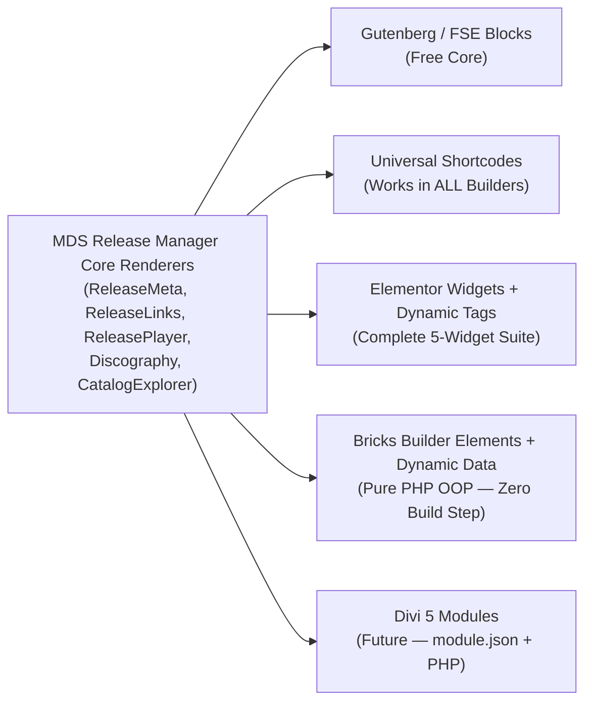

# Page Builder Integration Feasibility Research — MDS Release Manager

- **Date:** 2026-11-26
- **Scope:** WordPress 7.x page builder ecosystem, developer extension APIs, maintenance cost, and Free Core vs. Paid Extension placement (`mds-product-tiers.md`).
- **Audience:** Indie artists, record labels, agencies, and multi-site music networks using MDS Release Manager.

---

## 1. Current Baseline in `mds-release-manager`

| Layer | Current Status | Notes |
| :--- | :--- | :--- |
| **Gutenberg / Block Editor (FSE)** | **Full First-Class Support** | 5 native blocks (`release-meta`, `release-links`, `release-player`, `artist-discography`, `catalog-explorer`) + `ThemeScheme` + `BlockDefaults`. |
| **Universal Shortcodes** | **Full Support** | `[release-meta]`, `[release-links]`, `[release-player]`, `[artist-discography]`, `[catalog-explorer]` — works inside **every** page builder immediately via each builder's Shortcode widget. |
| **Builder Detection** (`BuilderDetection.php`) | **5 Builders Detected** | Detects Elementor, Divi (4 & 5), Bricks, WPBakery, and Beaver Builder so fallback templates never duplicate layouts. *(Missing: Breakdance, Oxygen.)* |
| **Elementor Integration** (`src/Integrations/Elementor/`) | **Partial Support** | Has Release Meta widget, Release Links widget, and Release Meta dynamic tag. Missing Release Player, Artist Discography, and Catalog Explorer widgets. |

---

## 2. Page Builder Feasibility Scoring Matrix

| Builder | Founded (Age) | Market Share / Adoption | User Pricing Model | Developer Extension API | Longevity (5–10 yr) | WP Implementation Effort | Verdict |
| :--- | :--- | :--- | :--- | :--- | :--- | :--- | :--- |
| **WordPress Block Editor (Gutenberg / FSE)** | 2018 (8 yrs) | **100% of WP** (Core default; fast-growing FSE adoption) | Free (Core) | `block.json` + PHP `render_callback` + Block Bindings / Interactivity API | **Very High** (WordPress Core) | **Already Built** | **Core Standard (Maintain First)** |
| **Elementor** | 2016 (10 yrs) | **~33–34% of all WP sites** (10M+ active installs; >40% of builder market) | Freemium + Pro subscription | Clean OOP PHP (`\Elementor\Widget_Base`, Dynamic Tags); V4/Atomic CSS transition underway | **Very High** (Market leader) | **Low** (1–2 days to add missing 3 widgets) | **Build Now (Complete Suite)** |
| **Bricks Builder** | 2021 (5 yrs) | **~0.4–0.5% overall, +30%+ YoY** (fastest-growing pro/agency builder) | Paid (Lifetime / Annual) | Pure OOP PHP (`\Bricks\Element`, `set_controls()`, `render()`, Dynamic Data provider) — **zero Node build step required** | **High** (Profitable, strong agency momentum) | **Low** (2–3 days for all 5 elements + Dynamic Data) | **Build Next (Highest ROI for Pro/Agency)** |
| **Divi (Divi 5)** | 2013 (13 yrs) | **~5.5–6% of WP sites** (huge loyal lifetime-license base) | Paid (Annual / Lifetime) | **Divi 5:** `module.json` + TypeScript/React + PHP server render (Yarn build pipeline); Divi 4 legacy shortcodes deprecated | **High** (Established profitable company; Divi 5 rebuild) | **High** (1–2 weeks due to Divi 5 JS/TS build + dual 4/5 transition) | **Build Later (Wait for Divi 5 Ecosystem Stabilization)** |
| **Breakdance** | 2022 (4 yrs) | Small but growing Elementor alternative (from Oxygen team) | Paid (Annual) | **Element Studio** (visual-to-PHP/Twig generator) — requires Breakdance-specific Twig workflow | **Medium–High** | **Medium** (4–5 days + Twig maintenance) | **Detection + Shortcodes Only** *(native elements on demand)* |
| **Beaver Builder** | 2014 (12 yrs) | **~0.3–0.4% of WP sites** (stable enterprise/agency niche) | Freemium + Paid | Mature PHP module API (`FLBuilderModule`) | **High** (Stable, conservative) | **Medium** (3–4 days) | **Detection + Shortcodes Only** *(low growth)* |
| **WPBakery** | 2011 (15 yrs) | **~8% of WP sites** (declining YoY; propped up by legacy ThemeForest bundles) | Bundled / Paid | Legacy shortcode-mapping API (`vc_map()`) | **Low–Medium** (Legacy decline) | **Low** (1–2 days via `vc_map()`) | **Skip Native Widgets** *(Shortcodes already work natively)* |
| **Oxygen** | 2016 (10 yrs) | Small / declining (users migrating to Bricks or Breakdance) | Paid | Legacy PHP API (`OxyEl`); fragmented between Classic & Oxygen 6 | **Low–Medium** | **Medium** | **Skip** *(Detection + Shortcodes only)* |

---

## 3. Single Source of Truth (SSOT) Adapter Architecture

Every native builder widget/element should be a **thin adapter (<120 lines)** that collects builder controls and delegates rendering directly to our canonical PHP block renderers — ensuring zero duplicated markup, styling, or security logic across builders:

---

## 4. Product Tier Alignment (`mds-product-tiers.md`)

1. **Free Core (`mds-release-manager`):**
   - **Gutenberg / FSE** (all 5 blocks — always first-class).
   - **Universal Shortcodes** (guarantees 100% compatibility with Divi, Bricks, Breakdance, Beaver Builder, WPBakery, Oxygen, and Classic themes).
   - **`BuilderDetection`** (lightweight guard so fallback templates never clash — add **Breakdance** detection alongside Elementor, Divi, Bricks, WPBakery, and Beaver Builder).
   - **Basic Elementor Widgets** (already in Core; completing the remaining 3 thin widgets — Release Player, Artist Discography, Catalog Explorer — maximizes WordPress.org adoption across the ~33% Elementor market).
2. **Paid / Pro Strategy (Optional Future `mds-page-builders` Extension or Pro Bundle):**
   - **Bricks Builder** native elements + Dynamic Data provider (music agencies & high-end artist sites overwhelmingly pay for Pro tools).
   - **Divi 5** native modules (once Divi 5's public module API stabilizes cleanly, targeting the massive lifetime-license user base).
   - **Elementor Pro Loop / Dynamic Tags** (deep archive/query integration, WooCommerce + Release dynamic tags).

---

## 5. Prioritized Roadmap & Open Questions

### Recommended Priority Order
- **Tier 1 (Do Now — High Impact, Low Effort):**
  1. Complete **Elementor** parity by adding thin adapters for **Release Player**, **Artist Discography**, and **Catalog Explorer** (covers ~33% of all WordPress sites in 1–2 days).
  2. Add **Breakdance** detection to `BuilderDetection.php` (10 lines, prevents fallback duplication).
- **Tier 2 (Build Next — High Agency ROI, Pure PHP):**
  3. Build **Bricks Builder** native elements (all 5 components + Bricks Dynamic Data tags like `{mds_release_upc}`, `{mds_release_label}`, `{mds_artist_name}`). Zero JS build step; cleanest developer API in WordPress.
- **Tier 3 (Evaluate Later):**
  4. **Divi 5** (`module.json` + React/TS build) once demand justifies the heavier build/maintenance pipeline.
- **Explicitly Skip Native Widgets (Use Shortcodes):**
  - **WPBakery**, **Beaver Builder**, **Breakdance** (native Twig), **Oxygen** — our shortcodes already work cleanly in all four without taking on ongoing maintenance debt.

### Open Questions for Sign-Off
1. Should we **complete Elementor** (adding Release Player, Artist Discography, and Catalog Explorer widgets) inside **Free Core** to drive WordPress.org installs?
2. Should **Bricks Builder** (and future **Divi 5**) live in a dedicated **`mds-page-builders`** paid extension plugin, or stay in Core?
3. Do you personally use (or have clients on) **Divi**, **Bricks**, or **Breakdance** today that would bump one of them up to Tier 1?
