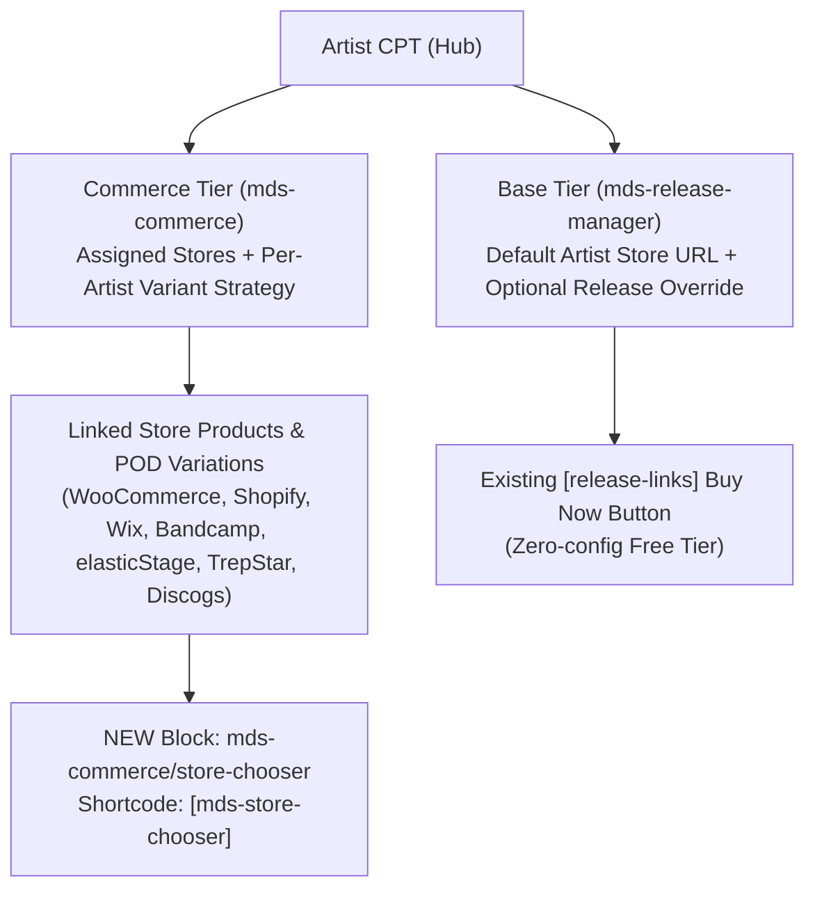

# Physical Media POD, Store Chooser Block & In-Place Rename Strategy

**Topic:** `physical-pod-and-store-chooser`  
**Companion To:** `commerce-platforms-feasibility.md`, `commerce-platforms-wp-capabilities.md`, `commerce-platforms-ai-audit.md`  
**Date:** 2026-11-26

---

## 1. Physical Media On-Demand (POD) Manufacturers for Artists & Labels

Independent artists increasingly avoid \$1,500–\$3,000 upfront pressing runs by mixing **on-demand vinyl/CD manufacturers** with digital downloads and merch. Research across the 2025–2026 ecosystem splits these manufacturers into two clean integration patterns:

| Manufacturer | Media Formats | Fulfillment Model | Integration Pattern | API / Webhook / URL Capabilities | Longevity & Cost | Verdict for `mds-commerce` |
| :--- | :--- | :--- | :--- | :--- | :--- | :--- |
| **elasticStage** | Vinyl LP + CD (True 1-unit POD) | Hosted storefront & checkout on `elasticstage.com` (SoundCloud partner; Shopify app pathway) | **External Link / WPC External Variation** | Unique per-release store URL (`elasticstage.com/<artist>/releases/...`); no open public create-product API | **High** (strong indie/SoundCloud backing; \$0 upfront, per-unit rev split) | **Build Now (External Variation + Store Chooser)** |
| **TrepStar** | CD, DVD, USB (True 1-unit POD; *no vinyl*) | Drop-ship from your cart **or** hosted purchase link | **Drop-Ship Webhook/SKU Match** *or* **External Variation** | Native Shopify JSON webhook (`ShopifyWebhookJSON.asp`), official `WooTrepStar` WP plugin, and Direct HTTP GET/POST Gateway API (matches SKU → `eCommerceIDString`) | **High** (established 20+ yr media duplicator; \$0/mo, pay per unit) | **Build Now (SKU-Synced Variation + Optional External Link)** |
| **Kunaki** | CD + 12"/7" Lathe-Cut Vinyl (True 1-unit POD, 24-hr turnaround) | Drop-ship from your cart **or** hosted product page | **Drop-Ship XML/HTTP API** *or* **External Variation** | XML, HTTP, CSV, and PayPal drop-ship APIs; ~\$0.75–\$2.20 CD, ~\$36–\$45 vinyl | **High** (long-running profitable POD plant; \$0/mo) | **Tier 2 (External Link + Optional XML Fulfillment)** |
| **Diggers Factory** | Pressed Vinyl, CD, Cassette, Merch (Crowdfunded/Pre-Order ~100 MOQ or Direct) | Hosted campaign page & global warehousing | **External Link / WPC External Variation** | Public campaign/release URL; no open catalog write API | **High** (major EU/US indie vinyl platform) | **Build Now (External Variation + Store Chooser)** |
| **Qrates** | Pressed Vinyl (Crowdfunded/Pre-Order) | Hosted campaign page | **External Link / WPC External Variation** | Public project URL; no open catalog write API | **Medium** (niche vinyl crowdfunding) | **Build Now (External Variation + Store Chooser)** |

### How `wpc-external-variations` Bridges Physical POD Inside WooCommerce

Inspected directly from the installed `wpc-external-variations` (`v1.1.1`) source (`wpc-external-variations.php`):
- **Detection:** `class_exists( 'WPCleverWpcev' )` or `defined( 'WPCEV_VERSION' )`.
- **Exact Variation Post Meta Keys (on `product_variation`):**
  - `wpcev_url` — External checkout URL (validated via `wp_http_validate_url()`).
  - `wpcev_text` — Custom button label override (e.g., `"Order Vinyl on elasticStage"` or `"Buy CD via TrepStar"`).
- **Capabilities Flag:** `WooCommerceLocal::get_capabilities()` auto-detects whether `wpc-external-variations` is active on a given WooCommerce spoke site and advertises `supports_external_variations: true` in the Hub UI.
- **Hybrid Single-Product Flow (One Release = One Variable WooCommerce Product):**
  - **Variation 1 (Vinyl LP):** External Variation → `wpcev_url = https://elasticstage.com/...`, `wpcev_text = "Order Vinyl (On-Demand)"`.
  - **Variation 2 (CD):** Either Local WooCommerce variation with `SKU = {TrepStar eCommerceIDString}` (fulfilled by `WooTrepStar` / TrepStar HTTP Gateway) **or** External Variation pointing to a TrepStar/Kunaki checkout link.
  - **Variation 3 (Digital Download):** Standard WooCommerce downloadable variation (or External Variation pointing to Bandcamp).
- **Graceful Fallback:** If `wpc-external-variations` is *not* active on a WooCommerce store, `mds-commerce` surfaces a capability badge explaining that external-link formats will be seeded as separate `WC_Product_External` products (or rendered in the **Store Chooser** block instead of a single variable product).

---

## 2. Base "Buy Now" vs. New "Store Chooser" Block & Shortcode

Separating **base free-tier Buy Now** from **multi-store Commerce** creates a super clean boundary between `mds-release-manager` and `mds-commerce`:



### A. Base Free Tier (`mds-release-manager`)
- **Artist CPT:** Add an `artist_default_store_url` (and optional label, e.g., `"Shop Official Store"`).
- **Release CPT:** Existing `buy_now_link` acts as an optional per-release override; if blank, `[release-links]` gracefully falls back to the Artist's default store URL.
- **Benefit:** Zero-budget solo artists get a working Buy Now button across their entire discography by entering **one URL** on their Artist profile—no commerce plugin required.

### B. Multi-Store Visitor Picker (`mds-commerce`)
- **New Gutenberg Block:** `mds-commerce/store-chooser` (API v3 `block.json`, in the `mds-release-manager` block category) + **Shortcode:** `[mds-store-chooser release_id="..." layout="grouped|list|cards" group_by="format|store"]`.
- **Visitor Experience:**
  - Lets fans choose their preferred format and/or storefront (e.g., **Vinyl LP** → *Official WooCommerce Store* / *elasticStage On-Demand* / *Discogs*; **CD** → *TrepStar* / *Bandcamp*; **Digital** → *Bandcamp* / *Shopify*).
  - Displays optional cached **price**, **stock/availability badge** (`In Stock`, `Pre-Order`, `Made on Demand`, `Sold Out`), and **region/fulfillment hint** (e.g., *Ships from US/EU*).
  - Supports **inline checkout embeds** when a store supports it (e.g., Shopify Storefront Web Components drawer right inside the chooser) while cleanly opening external links (`elasticStage`, `Bandcamp`, `Big Cartel`) in a new tab with `rel="noopener noreferrer"`.
  - Inherits `MDS Release Manager`'s `--mds-theme-*` light/dark CSS custom properties and meets Section 508 WCAG 2.1 AA (`role="tablist"` / `aria-live` status updates).

---

## 3. Per-Artist Variant Strategy & Per-Store Sync Modes

### Per-Artist Variant Strategy (Configured on Artist CPT)
Admins set the preferred strategy per Artist (or per Artist × Store pair), guided by auto-detected store capability badges:
- **`variable_product`** — One product with Format variations (Vinyl, CD, Cassette, Digital). Auto-enables `wpc-external-variations` mapping when active on WooCommerce, or native variants on Shopify/Wix/Big Cartel.
- **`separate_products`** — One product per format (best for stores without external variations, or labels that want distinct SEO pages for Vinyl vs. CD).
- **`ask_on_seed`** — Let the editor choose per release in the Create Product modal (pre-selecting the store's recommended default).

### Per-Store Sync Mode Controls (Configured per Store Connection)
Each remote store connection lets the admin pick the sync mode that fits their hosting/firewall environment:
1. **`webhook` (Real-time):** Registers/verifies signed inbound webhooks at `POST /mds-commerce/v1/webhooks/{provider}/{store_id}` (ideal for live public Hubs on Shopify / Big Cartel / WooCommerce Remote).
2. **`polling` (Scheduled):** Uses Action Scheduler (or WP-Cron fallback) on a configurable interval (e.g., hourly / twice daily) to refresh price, stock, and drift snapshots (ideal for LocalWP, firewalled hubs, or Bandcamp/Wix).
3. **`manual` (On-Demand Only):** Zero background traffic; syncs only when an admin clicks **"Check Drift"**, **"Sync Now"**, or **"Refresh Store"** in the UI.
- All three modes expose manual **"Test Connection"**, **"Refresh Catalog Cache"**, and **"Sync Now"** buttons.

---

## 4. In-Place Rename & GitHub Migration Runbook (`mds-woocommerce` → `mds-commerce`)

Because we are renaming **`mds-woocommerce` in place**, git history stays intact while existing WordPress sites transition cleanly:

### Step 1: Rename Repository on GitHub
1. Open `https://github.com/bwalton64/mds-woocommerce/settings`.
2. Under **General → Repository name**, change `mds-woocommerce` → `mds-commerce` and click **Rename**.
3. *Note:* GitHub automatically sets up HTTP/git redirects from `bwalton64/mds-woocommerce` → `bwalton64/mds-commerce` as long as you do not create a new repo with the old name.

### Step 2: Rename Local Folder & Update Git Remote (Windows / LocalWP)
1. Deactivate `MDS WooCommerce Integration` in LocalWP (or prepare to reactivate under the new folder name).
2. Rename the folder:
   ```powershell
   Rename-Item "C:\Users\Brian\Local Sites\bgw-dev\app\public\wp-content\plugins\mds-woocommerce" "mds-commerce"
   ```
3. Update the local Git remote URL so pushes/pulls point directly to the new canonical URL:
   ```powershell
   cd "C:\Users\Brian\Local Sites\bgw-dev\app\public\wp-content\plugins\mds-commerce"
   git remote set-url origin https://github.com/bwalton64/mds-commerce.git
   git remote -v
   ```
4. Update the main plugin file (`git mv mds-woocommerce.php mds-commerce.php`), `composer.json` PSR-4 namespace (`MDS\Commerce\`), `package.json`, `.agents/rules/project-config.md`, `languages/mds-commerce.pot`, and `ExtensionApi::register_github_updater()` (`slug => 'mds-commerce'`, `repo => 'bwalton64/mds-commerce'`).
5. Run `composer dump-autoload` and reactivate **`MDS Commerce`** in WordPress; the idempotent `UpgradeRoutine` automatically migrates `_mds_wc_target_stores`, `_mds_linked_products`, and `mds_wc_product_injection` on first boot.

---

## 5. Confirmed Architecture Decisions & Provisioning Feasibility

1. **Free Tier vs. Commerce Split:**
   - **`mds-release-manager` (Base Free Tier):** Artist CPT gains a simple Default Store URL (`artist_default_store_url`) with an optional simple per-release Buy Now override.
   - **`mds-commerce` (Multi-Store Companion):** Owns multi-format/multi-store management and introduces the **`mds-commerce/store-chooser`** Gutenberg block + **`[mds-store-chooser]`** shortcode.
2. **Phase 1 Launch Scope (`mds-commerce` v3.0.0):**
   - In-place rename of `mds-woocommerce` → `mds-commerce` (preserving git history).
   - Core provider architecture (`CommerceProviderInterface`, `StoreKey`, `UpgradeRoutine`, per-artist variant strategy, per-store sync mode controls: Webhook / Polling / Manual).
   - **WooCommerce Local + `wpc-external-variations`** (`wpcev_url` / `wpcev_text`) as the inaugural Tier 1 provider, followed by Shopify (Admin GraphQL), WooCommerce Remote (REST v3), Wix (Catalog V3), Big Cartel, Squarespace, Bandcamp Prep, and Discogs CSV in subsequent phases.
3. **Store Chooser Visitor UX & Promo Prioritization:**
   - Default layout: **Grouped by Media Format** (Vinyl, CD, Cassette, Digital), listing available stores under each format with price/stock badges.
   - **Admin Promo & Coupon Prioritization:** Each store connection (and/or release link) supports optional `promo_badge` (e.g., `"Free Shipping"`, `"15% Off"`), `coupon_code` (with 1-click copy), `promo_expires_gmt`, and `priority_weight`. Stores with active coupons/special offers can be auto-boosted to the top of each format group.
4. **Physical Media POD: Checkout vs. Provisioning Reality Check:**
   - **Mobile-Friendly Local Checkout (Drop-Ship Fulfillment):**
     - **TrepStar** (HTTP Gateway API / JSON Webhook) and **Kunaki** (XML/HTTP API) **do** support full native WooCommerce/Shopify checkout with automated drop-ship order submission on payment—completely eliminating their kludgy hosted carts for visitors.
     - **elasticStage / Diggers Factory / Qrates** do **not** expose a public drop-ship order API today, so they must route visitors via `wpc-external-variations` (`wpcev_url`) or the Store Chooser block (until an official order API opens).
   - **Portal Provisioning Automation (Cross-Origin Security Constraint):**
     - Standard WordPress admin JavaScript **cannot** auto-fill fields inside a cross-origin popup window (`trepstar.com`, `elasticstage.com`) due to browser Same-Origin Policy.
     - **Recommended Sanctioned Path (3-tier):**
       1. **Built-in Provisioning Drawer (Phase 1, zero dependencies):** Opens the manufacturer's create-release page alongside a WordPress side-panel with 1-click Copy buttons and print-ready asset/tracklist downloads.
       2. **WordPress Abilities / MCP (`mds-commerce/get-pod-provisioning-pack`, Phase 1–2):** Exposes verified release metadata, tracklist, and artwork URLs via `wp_register_ability()` (`meta.mcp.public`) so a browser-capable AI agent (e.g., Antigravity browser agent / Playwright) can fill the portal form cleanly for human review.
       3. **Optional Companion Browser Extension (Future):** Reads the WP REST provisioning payload and auto-fills TrepStar/elasticStage/Kunaki tabs natively.

