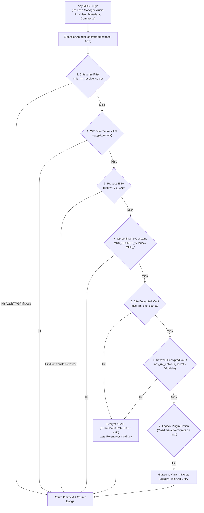

# Centralized Secrets Management — Ecosystem & Feasibility Research

> **Workspace Scope:** All MDS WordPress Plugins (`mds-release-manager`, `mds-audio-providers`, `mds-metadata`, `mds-commerce`)  
> **Date:** 2026-11-26  
> **Target Audience:** Solo indie artists on shared hosting, independent labels on managed WP/LocalWP, and multi-site label networks/agencies on cloud infrastructure  
> **Companion Capability Report:** [secret-vault-wp-capabilities.md](secret-vault-wp-capabilities.md)

---

## 1. Executive Summary

A live audit of the workspace revealed **four separate secret-handling mechanisms** across your four plugins:
- `mds-release-manager`: `wp-config.php` constants only (`MDS_RM_GITHUB_TOKEN`).
- `mds-audio-providers`: `Credentials` (`mds_ap_credentials`, OpenSSL `aes-256-gcm` / `cbc+hmac` / `b64:`, no `libsodium`, no `ENV`, no key rotation).
- `mds-metadata`: `CredentialStore` (`mds_md_credentials`, separate option + duplicated `spotify` and `musicfetch` keys + separate Gemini/OpenAI constants).
- `mds-commerce`: `CredentialVault` (`sodium_crypto_secretbox`, isolated to commerce stores, single `wp_salt('auth')` key, no AAD, no `ENV`, no key rotation).

### Strategic Recommendation

Build a **single, neutral, zero-dependency `SecretVault` + `SecretRegistry`** inside `mds-release-manager` Core (`ExtensionApi`), powered by **PHP 8.0+ native `libsodium` XChaCha20-Poly1305 AEAD (with AAD context binding)**, **key-ring rotation**, **Multisite Network/Site scoping**, **automatic `ENV` / `wp-config.php` / WP Core Secrets API delegation**, and a **unified Credentials UI**.

This gives zero-budget shared-hosting users bank-grade encrypted storage out of the box, eliminates duplicate API keys (like Spotify, Musicfetch, and GitHub tokens) across plugins, and lets enterprise/agency users plug in **Doppler**, **Infisical**, **AWS Secrets Manager**, or **HashiCorp Vault** with zero vendor lock-in via standard environment variables or a single `mds_rm_resolve_secret` filter.

---

## 2. Broad Ecosystem Discovery (Consume, Push, and Prep)

### A. Inbound (Read / Resolve Secrets)
- **Tier 0 — Runtime Overrides (Zero DB Footprint):** `mds_rm_resolve_secret` filter (for enterprise KMS/Vault mu-plugins) → WordPress Core Secrets API (`wp_get_secret()` when available) → Process Environment Variables (`getenv()` / `$_ENV` — works natively with Doppler, Infisical, Kubernetes Secrets, AWS ECS/EKS) → `wp-config.php` PHP constants.
- **Tier 1 — Encrypted WordPress Vault (Database-Safe):** `libsodium` XChaCha20-Poly1305 AEAD (`sodium_crypto_aead_xchacha20poly1305_ietf_encrypt`) with 192-bit random nonces, HKDF-derived 256-bit keys (`MDS_RM_SECRETS_KEY` / `WP_SECRETS_KEY` with `wp_salt()` fallback), and AAD binding (`namespace|field|scope|blog_id`). Network-level (`site_option`) + Site-level (`option`) cascade on Multisite.

### B. Outbound (Rotate, Audit & Hygiene)
- **Zero-Downtime Key Rotation:** Support `MDS_RM_SECRETS_KEY` + `MDS_RM_SECRETS_KEY_OLD` (key ring) with **lazy write-on-read re-encryption** AND a one-click **"Rotate / Re-encrypt All Vault Secrets"** admin tool.
- **Metadata-Only Audit Trail (`mds_rm_secret_audit`):** Log `who`, `when`, `action` (`updated`, `cleared`, `rotated`, `tested`), `namespace`, and `field` (bounded ring buffer, e.g., last 100 events) — **never** logging plaintext or ciphertext values.
- **Staging / Clone Safeguard:** Detect `wp_get_environment_type()` (`staging`, `development`, `local`) and optionally suppress live production secret usage or display a clear environment badge in the Credentials UI.

### C. Manual-Portal Automation (Prep Only)
- **`wp-config.php` & `.env` Snippet Generator:** Inside the unified **Credentials** admin screen, provide a one-click **"Generate `MDS_RM_SECRETS_KEY`"** button (using `random_bytes(32)` → `base64_encode()`) and a copy-ready `wp-config.php` / `.env` template listing all registered constant names for active MDS plugins (without ever printing saved secret values!).
- **Provider Setup Checklists:** Each registered schema can include a `docs_url` linking directly to the vendor developer portal (Spotify, SoundCloud, TIDAL, Jamendo, Discogs, Gemini, etc.).

---

## 3. Feasibility Scoring Matrix

| Candidate / Approach | Direction | Founded (Age) | Popularity & Adoption | Cost / Tiers | Rate Limits & Telemetry | Longevity Outlook (5–10 yr) | WP Implementation Effort | Verdict |
| :--- | :--- | :--- | :--- | :--- | :--- | :--- | :--- | :--- |
| **Core `SecretVault` (`libsodium` XChaCha20-Poly1305 + AAD + Key Ring)** | `Read` / `Write` / `Rotate` | 2013 (13 yrs, bundled in PHP 7.2+) | Industry-standard PHP AEAD primitive; zero dependencies | **\$0** (native PHP 8.0+) | Local CPU only (microseconds); zero network calls | **Very High** — RFC 8439 / libsodium standard bundled in PHP core | **Medium** (3–4 days incl. UI + tests) | **Build Now** |
| **ENV (`getenv`/`$_ENV`) + `wp-config.php` Constant Cascade** | `Read` | 1995+ (30+ yrs) | Universal 12-factor / WordPress standard | **\$0** | Zero overhead | **Very High** — foundational OS & PHP standard | **Low** (1 day, built into `SecretVault`) | **Build Now** |
| **WP Core Secrets API Bridge (`wp_get_secret` / `secrets.php`)** | `Read` / `Write` | 2025–2026 (WP 7.x) | Official WordPress core trajectory | **\$0** | Native WP; supports host `secrets.php` HSM/KMS drop-ins | **Very High** — official WordPress Core API | **Low** (0.5 day detect-and-delegate) | **Build Now** |
| **Shared Cross-Plugin Schema Registry (`mds_rm_register_secret_schemas`)** | `Read` / `Write` / `Prep` | Internal architecture | Eliminates duplicate Spotify, Musicfetch & GitHub keys across all 4 plugins | **\$0** | Local memory / single non-autoloaded option | **Very High** — owned by MDS Core | **Medium** (2–3 days across 4 plugins) | **Build Now** |
| **Audit Log + Key Rotation Tool + `wp-config` Prep Snippet** | `Audit` / `Prep` | Internal architecture | Standard enterprise security expectation | **\$0** | Bounded 100-entry ring buffer | **Very High** | **Low** (1–2 days) | **Build Next** |
| **Infisical** *(via ENV or `mds_rm_resolve_secret` adapter)* | `Read` / `Push` | 2022 (4 yrs) | Leading open-source (MIT) secrets manager | Free self-hosted core; Pro ~\$18–\$20/identity/mo; Cloud free tier | High API quotas; best used via ENV sync / local agent | **High** — strong OSS adoption + commercial backing | **Low** (zero code via ENV; 1–2 days for optional adapter) | **Optional Paid Provider** *(via ENV / filter)* |
| **Doppler** *(via ENV or CLI)* | `Read` | 2018 (8 yrs) | Popular developer SaaS secrets manager | Free (up to 3 users); Team ~\$21/user/mo; Enterprise on-prem | Best used via CLI/container ENV injection | **High** — established profitable SaaS | **Low** (zero code via ENV) | **Optional Paid Provider** *(via ENV)* |
| **AWS Secrets Manager** *(via mu-plugin filter / agent)* | `Read` / `Rotate` | 2018 (8 yrs) | Dominant AWS cloud secrets service | \$0.40/secret/mo + \$0.05 per 10k API calls | Requires local caching to avoid per-request HTTP latency | **Very High** — AWS core infrastructure | **Medium** (3–4 days for direct SDK; 0 days via ENV agent) | **Optional Paid Provider** *(via filter/drop-in)* |
| **HashiCorp Vault** *(via Vault Agent ENV / filter)* | `Read` / `Rotate` | 2015 (11 yrs) | Enterprise multi-cloud / HSM gold standard | Free Community (self-hosted); HCP ~\$1,150+/mo + client fees | High operational complexity; best via Vault Agent ENV | **Very High** — IBM/HashiCorp enterprise standard | **High** (direct) / **Low** (via Vault Agent ENV) | **Optional Paid Provider** *(via filter/drop-in)* |
| **WP 7.0 Connectors API (DB storage)** | `Read` / `Write` | 2026 (<1 yr) | New WP 7.0 AI settings screen | **\$0** | Stores UI-entered keys in **plain text** in `wp_options` | **Medium** (being superseded by WP Secrets API) | **Low** | **Skip** *(for DB storage; read ENV/constants only)* |
| **Composer Crypto Wrappers (`paragonie/halite`, `defuse/php-encryption`)** | `Read` / `Write` | 2015 (11 yrs) | Mature PHP libraries for legacy PHP 5/7 | **\$0** | Adds Composer version-conflict surface across sibling plugins | **Medium** — largely superseded by native PHP 8+ `libsodium` | **Low** | **Skip** *(use native PHP 8.0+ `libsodium`)* |

---

## 4. Architecture, Lock-In & Strategic Synthesis

### Centralized Resolution Cascade (Single Source of Truth)

### Shared Namespace Design (Eliminating Duplicate Keys)

Instead of each plugin storing its own copy of the same service's API key, schemas use **canonical service namespaces**:
- **`github`** — `token` (shared across all MDS plugins for GitHub auto-updates!)
- **`spotify`** — `client_id`, `client_secret` (shared by **both** `mds-audio-providers` and `mds-metadata`!)
- **`musicfetch`** — `api_key` (shared by **both** `mds-audio-providers` and `mds-metadata`!)
- **`soundcloud`**, **`tidal`**, **`jamendo`**, **`funkwhale`** — registered by `mds-audio-providers`
- **`discogs`**, **`apple_music_kit`**, **`odesli`**, **`soundcharts`**, **`muso_ai`**, **`kkbox`**, **`bandsintown`**, **`genius`**, **`ai_gemini`**, **`ai_openai`** — registered by `mds-metadata`
- **`commerce_store_<id>`** — per-store encrypted credentials registered/stored by `mds-commerce` via `SecretVault` (always `site_only` scope, bound to `blog_id` in AAD!)

### Tiered Budget Strategy

1. **Zero-Budget / Shared Hosting:** Works out of the box with zero configuration—secrets entered in **Releases → Settings → Credentials** are encrypted with `libsodium` XChaCha20-Poly1305 + AAD using a key derived from WordPress salts, with a gentle Site Health tip to define `MDS_RM_SECRETS_KEY` in `wp-config.php`.
2. **Developer / Agency / Staging-Prod Workflows:** Define `MDS_RM_SECRETS_KEY` (or per-service `ENV` vars / `wp-config.php` constants) using the built-in snippet generator. Database dumps/backups contain zero decryptable credentials.
3. **Enterprise / Multi-Label Networks:** Inject secrets via **Doppler**, **Infisical**, **AWS Secrets Manager**, or **HashiCorp Vault** using environment variables, WordPress's `wp-content/secrets.php` drop-in, or the `mds_rm_resolve_secret` filter—zero vendor lock-in.

### Security & Lock-In Safeguards

- **AAD Context Binding:** Every ciphertext authenticates `"{namespace}|{field}|{scope}|{blog_id}"` as AAD—copying an encrypted blob from `spotify` to `github` or from Blog 2 to Blog 1 fails authentication immediately.
- **No `b64:` Plaintext Fallback:** Unlike `mds-audio-providers`'s current `b64:` fallback when OpenSSL is missing, `SecretVault` should **refuse** to save unencrypted secrets to the database if neither `libsodium` nor `openssl` (`aes-256-gcm`) is available (returning a clear `WP_Error` instructing the admin to use `wp-config.php` / `ENV`).
- **Memory Scrubbing:** Call `sodium_memzero()` on derived binary keys and decrypted buffers where practical.
- **Strict Clean-Core Compliance:** `mds-release-manager` registers zero third-party service schemas itself (except optional `github` updater token when applicable). All DSP/AI/Commerce schemas are registered dynamically by their respective paid extensions.

---

## 5. Prioritized Roadmap & Open Questions

### Phase 1 — Core `SecretVault` & `SecretRegistry` (`mds-release-manager`)
- Implement `MDS\ReleaseManager\Core\Security\SecretVault` (`XChaCha20-Poly1305` + `AES-256-GCM` fallback, HKDF, AAD, key-ring rotation, `ENV`/`wp-config`/WP Secrets API cascade, `mds_rm_resolve_secret` filter).
- Implement `MDS\ReleaseManager\Core\Security\SecretRegistry` + `ExtensionApi` façade methods.
- Add unified **Credentials** tab in **Releases → Settings** (plus Network Admin on Multisite) with masked inputs, source badges, live **Test Connection**, **Generate `MDS_RM_SECRETS_KEY`** helper, and Site Health check.
- Full standalone PHP unit test suite (`tests/secret-vault.php`) covering encryption, AAD tamper rejection, key rotation, cascade precedence, and masking.

### Phase 2 — Migrate Sibling Extensions (Zero-Downtime Auto-Migration)
- Update `mds-audio-providers` (`Credentials`), `mds-metadata` (`CredentialStore` + `ImportColumnMapper`), and `mds-commerce` (`CredentialVault`) to delegate to `ExtensionApi` when present, register their canonical schemas (deduplicating `spotify`, `musicfetch`, and `github`), and transparently auto-migrate existing saved credentials on first read.

### Phase 3 — Audit Trail, Key Rotation Wizard & Enterprise Polish
- Add metadata-only audit log (`mds_rm_secret_audit`, last 100 events), one-click **Re-encrypt All Secrets** rotation button, staging-environment indicator (`wp_get_environment_type()`), and copy-ready `.env` / `wp-config.php` export template.

### Open Questions for Sign-Off
1. **Unified Credentials Tab vs. Inline Per-Plugin Drawers:** Should all plugin credentials live in a **single centralized "Credentials" tab** under **Releases → Settings** (with per-plugin tabs linking directly to it), or should both the centralized tab **and** existing inline provider drawers stay synced to the same `SecretVault`?
2. **Multisite Default Scope:** On Multisite, should shared catalog/streaming keys (Spotify, SoundCloud, TIDAL, Musicfetch, Discogs, Gemini/OpenAI) default to **Network-wide** (`manage_network_options`) with optional per-site override, while commerce store credentials stay **Site-only**?
3. **Strict Crypto Requirement:** Do you want `SecretVault` to **refuse** DB writes if neither `libsodium` nor `OpenSSL` is available (recommended for security), requiring `wp-config.php` / `ENV` on such hosts?
