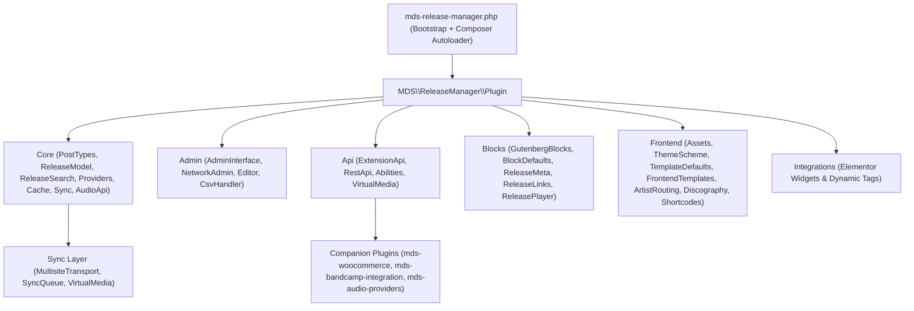

# MDS Release Manager — Technical Blueprint

**Plugin Slug:** `mds-release-manager`  
**Version:** `1.0.0` · **Extension API Version:** `2.0.0` (`MDS_RM_API_VERSION`)  
**PHP Root Namespace:** `MDS\ReleaseManager` (Composer PSR-4 → `src/`)  
**Compatibility:** WordPress `7.0+` (Tested up to `7.x`) · PHP `8.0+` · Multisite (`Network: true`)

---

## 1. High-Level Architecture



- **Modern Hybrid Architecture:** All 40 active PHP classes live in `src/` under PSR-4 namespace `MDS\ReleaseManager\*`. Legacy `includes/legacy-class-aliases.php` provides lazy `class_alias()` shims for backward compatibility with older companion plugins.
- **Public Extension Contract:** Companion plugins interact exclusively through `MDS\ReleaseManager\Api\ExtensionApi` (`MDS_RM_API_VERSION = '2.0.0'`) and documented `mds_rm_*` hooks.
- **Hub-and-Spoke Multisite:** One Master Hub site owns catalog authoring (`release` and `artist` CPTs); Spoke sites are read-only and receive diff-based broadcasts through `Sync`, `MultisiteTransport`, `SyncQueue`, and zero-duplication `VirtualMedia`.
- **Theme-Adaptive Presentation:** `ThemeScheme` inspects WordPress Global Styles (`wp_get_global_styles()` / `wp_get_global_settings()`) and WCAG luminance math to derive `--mds-theme-*` CSS custom properties for light and dark themes automatically.

---

## 2. Directory Structure

```text
mds-release-manager/
├── mds-release-manager.php          # Plugin bootstrap, constants, Composer autoloader
├── uninstall.php                    # Safe option cleanup + opt-in full network wipe
├── composer.json                    # PSR-4 autoloading + WPCS 3 / PHPCompatibilityWP
├── package.json                     # @wordpress/scripts + Playwright E2E
├── phpcs.xml.dist                   # WordPress Coding Standards ruleset
├── playwright.config.js             # Playwright E2E configuration
├── wpml-config.xml                  # WPML / Polylang translatable meta & options
├── README.md                        # Developer & repository documentation
├── readme.txt                       # WordPress.org directory readme
├── USER-MANUAL.md                   # End-user & site-admin manual
├── changelog.md                     # Append-only Keep a Changelog history
├── .agents/
│   ├── rules/project-config.md      # Plugin tokens & LocalWP paths
│   └── technical-blueprint.md       # This architectural reference
├── blocks/                          # Gutenberg blocks (API v3 block.json + editor scripts)
│   ├── release-meta/                # mds-rm/release-meta
│   ├── release-links/               # mds-rm/release-links
│   ├── release-player/              # mds-rm/release-player
│   ├── artist-discography/          # mds-rm/artist-discography
│   ├── color-control.js             # Shared theme-palette ColorControl
│   ├── core-block-extensions.js     # Core block metadata bindings
│   ├── native-release-styles.js     # Shared Block Inspector & Block Defaults primitives
│   ├── release-items.js             # Shared repeater/item controls
│   ├── release-picker.js            # Cached searchable Release Picker hook
│   └── style-control.js             # Shared responsive style utilities
├── css/                             # Admin & frontend block/fallback stylesheets
├── includes/                        # Admin PHP views & legacy class_alias() shims
├── js/                              # Admin workspaces (Release/Artist Manager, Settings, Previews) & frontend Player/Modal
├── languages/                       # mds-release-manager.pot
├── src/                             # PSR-4 namespace MDS\ReleaseManager\
│   ├── Config.php                   # Tier 2 constants, option keys, locale-aware transient helper
│   ├── Plugin.php                   # Central hook orchestrator
│   ├── Admin/                       # AdminInterface, CsvHandler, Editor, NetworkAdmin
│   ├── Api/                         # Abilities, ExtensionApi, RestApi, VirtualMedia
│   ├── Blocks/                      # BlockDefaults, GutenbergBlocks, ReleaseLinks, ReleaseLinksBlock, ReleaseMeta, ReleasePlayer
│   ├── Core/                        # BuilderDetection, Cache, Logger, PostTypes, Providers, ReleaseModel, ReleaseSearch, Sync, TemplateLoader
│   │   ├── Audio/                   # AudioApi, AudioProviderInterface, LocalPreviewProvider
│   │   └── Sync/                    # MultisiteTransport, SyncQueue, SyncTransportInterface
│   ├── Frontend/                    # ArtistRouting, Assets, Customizer, Discography, FrontendTemplates, Shortcodes, TemplateDefaults, ThemeScheme
│   └── Integrations/Elementor/      # LinksWidget, ReleaseMetaTag, Tags, Widget
├── templates/                       # Theme-overridable release-fallback.php & artist-fallback.php
└── tests/                           # 11 standalone PHP tests + Playwright e2e/ suite
```

---

## 3. Data Model (CPTs, Taxonomies & Options)

### Custom Post Types & Taxonomies (`src/Core/PostTypes.php`)
- **CPTs:** `release` (rewrite `release`, supports `title`, `editor`, `thumbnail`, `excerpt`) and `artist` (rewrite `artist`, submenu under `Releases`, supports `title`, `editor`, `thumbnail`, `excerpt`). On Spoke sites, `create_posts` is mapped to `do_not_allow`.
- **Taxonomies (on `release`):**
  - `release_type` (hierarchical — canonical Release Types: Single, EP, Album, Digital; term meta `_mds_release_type_icon`)
  - `release_media_format` (non-hierarchical — editable Media Formats; term meta `_mds_media_format_icon`)
  - `release_tag` (non-hierarchical — Release Tags)

### Core Options (`src/Config.php`)
- **Site Options:** `mds_rm_block_defaults`, `mds_rm_template_defaults`, `mds_rm_cache_settings`, `mds_rm_providers`, `mds_rm_audio_provider_priority`, `mds_rm_audio_disabled_providers`, `mds_rm_fa_support`, `mds_rm_network_sync_job`.
- **Network Site Options:** `mds_rm_master_blog_id`, `mds_rm_spoke_sites`, `mds_rm_db_templates`, `mds_rm_wipe_on_uninstall`.

### Key Post Meta Keys
- **Release:** `artist_id` (Artist UUID), `upc_ean`, `_mds_normalized_upc`, `release_date`, `record_label`, `distributor`, `buy_now_link`, `buy_now_links` (multi-format repeater), `buy_now_mode` (`picker` | `direct`), `audio_preview_url`, `streaming_links`, `release_routing_mode`, `release_routing_url`, `_mds_hub_post_id`.
- **Artist:** `_mds_artist_uuid`, `artist_website`, `artist_contact`, `artist_homepage_redirect`, `artist_releases_routing_mode`, `_mds_hub_post_id`.
- **Virtual Attachments (Spokes):** `_mds_hub_media_id` (`"{hub_blog_id}:{hub_attachment_id}"`), `_mds_is_hub_media` (Hub URL), `_mds_hub_media_dims`.

---

## 4. Gutenberg Blocks & Shortcodes

All 4 blocks are registered via `block.json` (API v3) in the `mds-release-manager` block category:

| Block Name | Block Title | Shortcode | Renderer Class |
| :--- | :--- | :--- | :--- |
| `mds-rm/release-meta` | Release Meta | `[release-meta]` | `MDS\ReleaseManager\Blocks\ReleaseMeta` |
| `mds-rm/release-links` | Release Links | `[release-links]` | `MDS\ReleaseManager\Blocks\ReleaseLinks` |
| `mds-rm/release-player` | Release Player | `[release-player]` | `MDS\ReleaseManager\Blocks\ReleasePlayer` |
| `mds-rm/artist-discography` | Artist Discography | `[artist-discography]` | `MDS\ReleaseManager\Frontend\Discography` |

---

## 5. REST API & WordPress Abilities (`mds/v1`)

| Route | Purpose |
| :--- | :--- |
| `GET /mds/v1/releases` | Paginated SQL-backed Release search (title, artist name, or exact UPC/EAN) |
| `GET /mds/v1/artists` | Paginated SQL-backed Artist search |
| `POST /mds/v1/releases/{id}/preview` | Server-rendered Live Release Preview modal HTML |
| `POST /mds/v1/artists/{id}/preview` | Server-rendered Live Artist Preview modal HTML |
| `POST /mds/v1/settings` | Save site settings (General, Cache, Default Templates, Block Defaults, Providers) |
| `POST /mds/v1/purge-cache` | Manual cache purge across enabled cache adapters |
| `POST /mds/v1/network-settings` | Save Multisite Hub/Spoke configuration |
| `POST /mds/v1/sync-network` | Trigger resumable batched Hub-to-Spoke sync |
| `GET /mds/v1/sync-network/status` | Poll asynchronous `SyncQueue` / batch job progress |
| `POST /mds/v1/artists/{id}/release-routing` | Bulk/individual Artist Release Routing table updates |
| `GET /mds/v1/releases/{id}/audio` | Just-in-Time Unified Audio API manifest resolution |
| `GET /mds/v1/audio-providers` | List registered audio preview providers & priorities |

**WordPress Abilities API (`src/Api/Abilities.php`):** Exposes core catalog and settings operations as WordPress Abilities with JSON Schema definitions and `meta.mcp.public` metadata for MCP discovery.

---

## 6. Public Hooks & Filters

### Actions
`mds_rm_loaded`, `mds_rm_register_custom_meta_boxes`, `mds_rm_save_release_meta`, `mds_rm_save_artist_meta`, `mds_rm_after_shadow_sync`, `mds_rm_purge_cache`, `mds_rm_after_cache_purge`, `mds_rm_before_discography_render`, `mds_rm_prime_release_picker_items`, `mds_rm_prime_artist_picker_items`, `mds_rm_prime_routing_destinations`, `mds_rm_log_message`.

### Filters
- **Context & Blocks:** `mds_rm_release_context_post`, `mds_rm_release_meta_context_upc`, `mds_rm_dynamic_block_context_attrs`, `mds_rm_discography_cell`, `mds_rm_detected_content_builder`.
- **Audio & Providers:** `mds_rm_audio_providers`, `mds_rm_audio_manifest`, `mds_rm_default_media_formats`.
- **Commerce & Routing:** `mds_rm_buy_now_links`, `mds_rm_buy_now_url`, `mds_rm_buy_now_display_mode`, `mds_rm_release_routing_modes`, `mds_rm_resolve_release_redirect_url`, `mds_rm_routing_destination_preview`.
- **Sync & Multisite:** `mds_rm_register_sync_transports`, `mds_rm_sync_targets`, `mds_rm_sync_target_sites`, `mds_rm_spoke_protected_meta_keys`, `mds_rm_sync_excluded_meta_keys`.
- **Admin, Theme & Assets:** `mds_rm_site_settings_tabs`, `mds_rm_network_settings_tabs`, `mds_rm_release_picker_item`, `mds_rm_artist_picker_item`, `mds_rm_theme_scheme`, `mds_rm_cache_adapters`, `mds_rm_detected_font_awesome_plugin`, `mds_rm_font_awesome_cdn_url`.

---

## 7. Build, Linting & Testing Toolchain

- **PHP Linting:** `composer phpcs` / `composer phpcbf` (WPCS 3.1 + PHPCompatibilityWP targeting PHP 8.0+).
- **JS/CSS Tooling:** `@wordpress/scripts` (`npm run build`, `npm run lint:js`, `npm run lint:css`).
- **Standalone PHP Tests (`tests/*.php`):** `audio-api.php`, `block-defaults.php`, `block-styles-parity.php`, `cache.php`, `customizer.php`, `release-search.php`, `settings-save.php`, `settings-tabs.php`, `sync.php`, `theme-scheme.php`, `uninstall.php`.
- **E2E Tests:** Playwright (`npm run test:e2e`, `tests/e2e/`).
