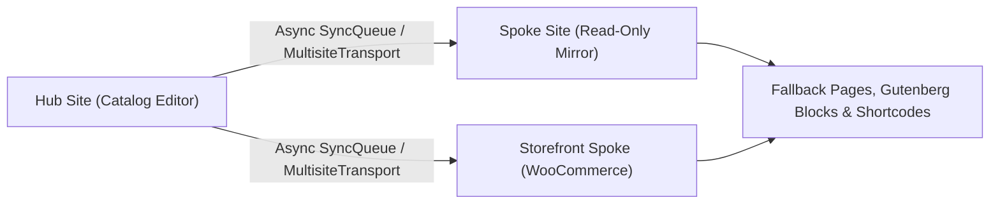
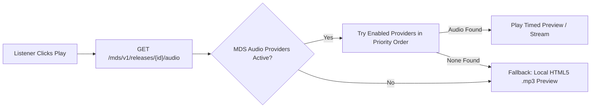

# MDS Release Manager — User Manual

**Version:** `2.0.0`  
**Requirements:** WordPress `7.0+` · PHP `8.0+` *(Optional companion plugins: MDS Audio Providers 2.0.0+, MDS WooCommerce Integration)*

## Table of Contents
1. [Overview](#overview)
2. [Installation & Setup](#installation--setup)
3. [Getting Started & Core Workflows](#getting-started--core-workflows)
4. [Settings Reference](#settings-reference)
5. [Frontend Display & Styling](#frontend-display--styling)
6. [Appendix: Blocks & Shortcodes Reference](#appendix-blocks--shortcodes-reference)
7. [Troubleshooting, Caching & FAQ](#troubleshooting-caching--faq)
8. [Uninstalling & Data Cleanup](#uninstalling--data-cleanup)

---

## 1. Overview

**MDS Release Manager** turns WordPress into a centralized music catalog for independent artists, record labels, and multi-site music networks. Manage **Artists** and **Releases** (UPC/EAN, Release Type, Media Formats, streaming links, multi-format Buy Now links, and audio previews) from one place, then display them anywhere using automatic fallback pages, four native Gutenberg blocks, Elementor widgets, or shortcodes.



---

## 2. Installation & Setup

### Single-Site Installation
1. Go to **Plugins → Add New → Upload Plugin** and upload `mds-release-manager-2.0.0.zip`.
2. Click **Install Now**, then **Activate**.
3. Open **Releases → Settings** to review your streaming providers, cache integration, and default block/template styles.

### Multisite (Hub-and-Spoke) Setup
1. In **Network Admin → Plugins**, **Network Activate** **MDS Release Manager**.
2. Go to **Network Admin → Settings → Release Manager** and select your **Hub (Master) Site** and target **Spoke Sites**.
3. Click **Save Network Settings**.
4. **How Hub-and-Spoke works:**
   - **Hub Site:** Full create, edit, trash, and delete access for Artists and Releases. Saving, trashing, restoring, or deleting on the Hub automatically queues an asynchronous sync to every configured Spoke site.
   - **Spoke Sites:** Catalog posts (`release` and `artist`) and taxonomies are **read-only** on Spokes to prevent data drift. Spoke admin lists display a notice linking directly back to the Hub editor.

### Optional Companion Plugins
- **MDS Audio Providers (`2.0.0+`):** Adds Apple Music, Deezer, Bandcamp, SoundCloud, and Spotify preview resolution to the core **Release Player** under **Releases → Settings → Audio Providers**.
- **MDS WooCommerce Integration:** Links Releases to WooCommerce products by UPC/SKU, adds product-page metadata, and enables white-label Buy Now store routing.

---

## 3. Getting Started & Core Workflows

### Creating an Artist
1. Navigate to **Releases → Artists → Add New Artist**.
2. Enter the Artist Name (Title), Biography (main editor), and Portrait (Featured Image).
3. In the **Artist Manager** workspace:
   - **Profile & Contact:** Add Contact Information and an optional **Official Homepage URL**.
   - **Homepage & Release Routing:** Choose whether visitors to the Artist page redirect to their Official Homepage, and set the default routing policy inherited by all Releases belonging to this Artist (`Fallback Page`, `Artist Website`, `Buy Now or Artist Website`, or `Buy Now or Fallback`).
   - **Release Routing Table:** Review, search, and bulk-update per-release routing overrides directly from the Artist screen.
4. Click **Live Artist Preview** next to **Add New Artist** to preview Desktop, Tablet (768px), and Mobile (390px) layouts before publishing.

> **Screenshot:** *Artist Manager workspace showing the Biography, Contact Info, and Release Routing table.*

### Creating a Release
1. Navigate to **Releases → Add New Release**.
2. Enter the Release Title, Description, Excerpt, and Cover Art (Featured Image).
3. In the **Release Manager** workspace:
   - **Identity & Catalog:** Enter the required **UPC/EAN** (leading zeroes are preserved; duplicates are prevented), select the **Release Type** (`Single`, `EP`, `Album`, or `Digital`), link an **Artist**, and optionally add **Record Label**, **Distributor**, and **Release Tags**.
   - **Streaming & Audio:** Add streaming platform URLs (Spotify, Apple Music, Bandcamp, etc.) and an optional **Core Audio Preview URL (`.mp3`)**.
   - **Buy Now & Routing:** Add one or more **Media Formats** (`Digital Download`, `CD`, `Vinyl LP`, etc.) with purchase URLs, mark one as **Primary**, choose the **Multi-Format Buy Now Behavior** (`Choose Format Modal` or `Primary Direct Link`), and optionally configure an **Advanced: Page Routing Override**.
4. Click **Live Release Preview** next to **Add New Release** to inspect Desktop/Tablet/Mobile output without modifying the database.

> **Screenshot:** *Release Manager tabbed workspace (Identity & Catalog, Streaming & Audio, Buy Now & Routing).*

### Managing Release Types & Media Formats
- **Releases → Release Types:** Assign Font Awesome or Dashicons icons to canonical Release Types (`Single`, `EP`, `Album`, `Digital`) using the visual **Icon Picker**.
- **Releases → Media Formats:** Add, edit, or assign icons to physical and digital purchase formats used by the Multi-Format Buy Now repeater and modal.

### Importing & Exporting via CSV
- Open **Releases → Import / Export CSV** to bulk-import Releases (validated for unique UPCs and valid Release Types) or export your full catalog in bounded batches.

---

## 4. Settings Reference

Navigate to **Releases → Settings** to configure site-wide behavior across three core tabs (plus any companion extension tabs such as **Audio Providers**):

### Tab 1: General Settings
| Section | Setting | Default | What It Does |
| :--- | :--- | :--- | :--- |
| **Cache Management** | Per-Plugin Purge Mode | Auto-detected | Supports 9 cache plugins (LiteSpeed, WP Rocket, W3TC, WP Fastest Cache, SiteGround Optimizer, WP Super Cache, Autoptimize, FlyingPress, Breeze) with `Purge All`, `Purge CSS & JS Only`, or `Disabled` modes plus a manual **Purge Cache Now** button. |
| **Cache Management** | Purge on Post Save | Checked | Automatically purges caches when individual Releases or Artists are saved. |
| **Network Synchronization** | Run Manual Sync | — | Resumable batch broadcast of all Artists and Releases from the Hub to all configured Spokes. |
| **Font Awesome Integration** | Font Awesome Source | `Auto` | Defers to an active Font Awesome plugin if detected; otherwise loads Font Awesome Free 6.7.2 from cdnjs with SHA-512 Subresource Integrity (or select `Theme` / `None`). |

### Tab 2: Default Templates
Customize the automatic **Release Fallback Template** and **Artist Fallback Template** rendered when no page builder or routing redirect is active:
- **Detected Theme Scheme & Starter Presets Bar:** Automatically detects your active theme's light/dark color scheme (including Twenty Twenty-Five *Default*, *Evening*, *Midnight*, *Afternoon*, etc.) and lets you apply **Auto-Match Theme**, **Twenty Twenty-Five — Light**, or **Twenty Twenty-Five — Evening (Dark)** in one click.
- **Sticky Live Preview:** Open by default side-by-side with an **Active Theme / Light / Dark** canvas switcher and **Show/Hide Live Preview** toggle.
- **Controls:** Layout (`Split` / `Stacked`), Split Ratio, Sticky Cover Art, Container Surface/Border/Radius, Image Aspect/Shadow, Component Order, Typography, Discography Heading, and Artist Contact Card styling.

> **Screenshot:** *Releases → Settings → Default Templates with the sticky Live Preview and Theme Scheme preset bar.*

### Tab 3: Block Defaults
Configure site-wide presentation and behavior defaults for all four blocks — **Release Meta**, **Release Links**, **Release Player**, and **Artist Discography**:
- **Detected Theme Scheme & Starter Presets Bar:** Apply **Auto-Match Theme**, **Twenty Twenty-Five — Light**, or **Twenty Twenty-Five — Evening (Dark)** across all four blocks at once.
- **Sticky Live Preview:** Real-time frontend-accurate preview for every block tab with **Active Theme / Light / Dark** canvas switching.
- **Unified Color Picker:** Click any color control to pick directly from your active theme's palette swatches or a custom hex/alpha color, or reset to inherit the theme default.
- **Per-Block Overrides:** Newly inserted and existing blocks inherit Block Defaults automatically unless overridden on an individual block.

> **Screenshot:** *Releases → Settings → Block Defaults showing the Release Player tab and real-time Live Preview.*

---

## 5. Frontend Display & Styling

- **Automatic Fallback Pages:** Singular Release and Artist pages render clean, responsive layouts automatically unless a page builder (Elementor, Divi, Bricks, WPBakery, Beaver Builder) or a 302 Routing Redirect is active. Placing a manual Release Meta, Release Links, or Artist Discography block/shortcode suppresses the matching automatic component so nothing duplicates.
- **Automatic Theme Color Matching:** Unset colors automatically inherit `--mds-theme-*` CSS custom properties derived from your active theme's WordPress Global Styles (`theme.json`), adapting cleanly between light and dark variations such as **Twenty Twenty-Five Default** and **Twenty Twenty-Five Evening**.
- **Audio Preview Fallback:** The core **Release Player** resolves audio Just-in-Time when a listener clicks Play (zero remote requests on page load). If **MDS Audio Providers** is installed, it follows your configured priority order and automatically falls back to the release's local `.mp3` preview URL if needed.



---

## 6. Appendix: Blocks & Shortcodes Reference

### Gutenberg Blocks (Category: **MDS Release Manager**)

| Block Title | Block Name | Where to Use | Key Inspector Controls |
| :--- | :--- | :--- | :--- |
| **Release Meta** | `mds-rm/release-meta` | Release pages, Query Loops, Posts/Pages | Searchable Release Picker, per-field visibility/order/icon/tooltip, **Container & Layout**, **Typography & Text**, **Icons** |
| **Release Links** | `mds-rm/release-links` | Release pages, Query Loops, Posts/Pages | Searchable Release Picker, **Open links in a new tab**, **Multi-format Buy Now behavior**, per-provider overrides, **Container & Layout**, **Button Styling** |
| **Release Player** | `mds-rm/release-player` | Release pages, Query Loops, Posts/Pages | Searchable Release Picker, **Audio Provider**, **Player Modules & Source**, **Preview & Sampler Playback**, **Colors & Surface Styling** (6 colors, radius, border, padding, max width, shadow) |
| **Artist Discography** | `mds-rm/artist-discography` | Artist pages, Posts/Pages | Searchable Artist Picker, **Outer Section Box** (native WP supports), **Table Frame & Base Text**, **Column Headers**, **Table Rows & Zebra Striping**, **Cells, Grid Borders & Links** |

### Shortcodes

#### `[release-meta]`
| Attribute | Default | Description |
| :--- | :--- | :--- |
| `release_id` | Current post | Explicit Release post ID (takes precedence over `upc`). |
| `upc` | `""` | Exact UPC/EAN lookup (leading zeroes significant). |
| `fields` | `release_year,record_label,distributor,upc_ean` | Comma-separated ordered list of fields (`release_year`, `record_label`, `distributor`, `upc_ean`, `release_type`, `release_media_format`, `release_date`, `release_title`, `artist`, `release_tags`). |
| `icon_{field}` / `title_{field}` | Field default | Override icon CSS class or tooltip for a specific field. |
| Style attributes | Inherited | `background`, `color`, `icon_color`, `font_family`, `font_size`, `font_weight`, `font_style`, `line_height`, `letter_spacing`, `text_align`, `gap`, `padding`, `margin`, `border_width`, `border_style`, `border_color`, `radius`, `icon_size`, `icon_opacity`, `icon_gap` (add `_tablet` / `_mobile` suffixes for responsive overrides). |

```text
[release-meta release_id="123" fields="release_year,record_label,release_type,upc_ean" gap="14px" radius="6px"]
```

#### `[release-links]`
| Attribute | Default | Description |
| :--- | :--- | :--- |
| `release_id` / `upc` | Current post | Explicit Release ID or UPC/EAN lookup. |
| `order` / `hide` | Site provider order | Comma-separated provider names (use `__buy_now` for Buy Now). |
| `new_tab` | `1` | Open links in a new tab (`1` or `0`). |
| `buy_now_mode` | `picker` | Multi-format Buy Now behavior (`picker` or `direct`). |
| `icon_{provider}` / `title_{provider}` | Provider default | Override icon or tooltip (e.g. `icon_apple_music`, `title_buy_now`). |
| Style attributes | Inherited | `background`, `align`, `vertical_align`, `direction`, `wrap`, `width`, `padding`, `margin`, `border_width`, `border_style`, `border_color`, `radius`, `link_gap`, `button_size`, `button_radius`, `button_color`, `button_background`, `button_border_width`, `button_border_style`, `button_border_color`, `icon_size`, `hover_opacity` (supports `_tablet` / `_mobile`). |

```text
[release-links release_id="123" order="Spotify,Apple Music,__buy_now" button_size="48px" new_tab="1"]
```

#### `[release-player]`
| Attribute | Default | Description |
| :--- | :--- | :--- |
| `release_id` / `upc` | Current post | Explicit Release ID or UPC/EAN lookup. |
| `provider` | `""` (Auto) | Force a specific audio provider slug (e.g. `apple_music`, `deezer`, `local`), or leave empty for automatic priority fallback. |
| `show_artwork`, `show_meta`, `show_progress`, `show_time`, `show_provider_badge` | `1` | Toggle individual player modules (`1` or `0`). |
| `show_tracklist`, `compact` | `0` | Show expandable tracklist or compact bar layout (`1` or `0`). |
| `sampler_mode` | `1` | Auto-advance across multi-track releases with crossfade (`1` or `0`). |
| `preview_seconds` | `20` | Fallback clip length in seconds (`10`–`60`) for full-length streams. |
| `crossfade_ms` | `1500` | Crossfade duration in milliseconds (`0`–`4000`). |
| Style attributes | Theme-adaptive | `background_color`, `text_color`, `muted_color`, `accent_color`, `play_icon_color`, `border_color`, `border_radius` (`0`–`32`), `border_width` (`0`–`6`), `padding` (`0`–`32`), `max_width` (e.g. `480px`), `shadow` (`none`, `subtle`, `elevated`). |

```text
[release-player release_id="123" max_width="480px" shadow="subtle" show_tracklist="1"]
```

#### `[artist-discography]`
| Attribute | Default | Description |
| :--- | :--- | :--- |
| `artist_id` | Current Artist | Explicit Artist post ID. |
| `striped` | `0` | Enable alternating row striping (`1` or `0`). |
| Table & wrapper style attributes | Theme-adaptive | `table_*`, `header_*`, `body_*`, `cell_*`, `link_*`, `stripe_background`, and `wrapper_*` attributes matching the Gutenberg Styles panel. |

```text
[artist-discography artist_id="42" striped="1" cell_padding_top="10px" cell_padding_bottom="10px"]
```

---

## 7. Troubleshooting, Caching & FAQ

- **Release or Artist pages return 404 after activation:** Go to **Settings → Permalinks** and click **Save Changes** to flush WordPress rewrite rules.
- **Style changes in Block Defaults or Default Templates don't appear immediately for logged-out visitors:** Open **Releases → Settings → General Settings** and click **Purge Cache Now** (or verify your cache plugin adapter isn't set to `Disabled`).
- **Cannot edit Releases or Artists on a Multisite sub-site:** Spoke sites are intentionally read-only. Click the Hub link shown in the top notice to edit on the Hub site; changes sync automatically to Spokes.
- **Release Player doesn't appear for a Release:** The player hides itself cleanly when a Release has no audio preview available from any enabled provider or `audio_preview_url`. Add a local `.mp3` preview URL or verify the Release's UPC/EAN with **MDS Audio Providers**.
- **Icons appear as empty boxes:** Check **Releases → Settings → General Settings → Font Awesome Integration** and ensure it is set to `Auto` (or `CDN`) if your theme does not bundle Font Awesome 6.

---

## 8. Uninstalling & Data Cleanup

- **Deactivating** the plugin leaves all Releases, Artists, taxonomies, and settings intact.
- **Deleting** the plugin via **Plugins → Delete** removes site-level plugin options (`mds_rm_*`) while **preserving your Release and Artist posts by default**.
- On Multisite, if you explicitly opt in to **Wipe all data on uninstall** under **Network Admin → Settings → Release Manager**, deleting the plugin permanently removes network settings, site options across the network, and all Release and Artist posts (including Trash).
